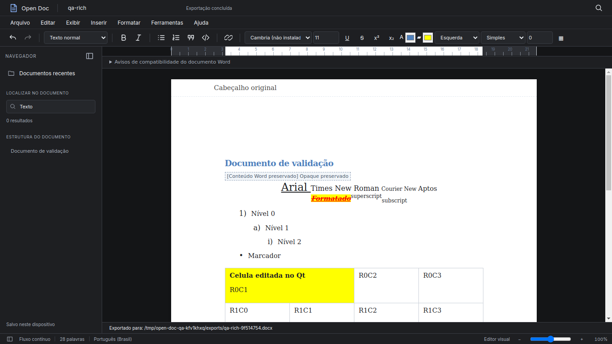

# Open Doc

Open Doc é um editor de documentos desktop local-first construído com o Vela Framework.
O editor visual abre numa folha branca, com menus clássicos, estrutura de títulos,
busca local e ferramentas de formatação. Sem conta, nuvem ou CDN.



## Executar

Requer Python 3.10+, Git, dependências Qt e uma sessão gráfica.

```powershell
git clone https://github.com/zxlawdx/open-doc.git
cd open-doc
python -m venv .venv
.\.venv\Scripts\Activate.ps1
python -m pip install -r requirements.txt
python manage.py collectstatic --no-tailwind
python manage.py runapp
```

Para atualizar um clone existente, use `git pull origin main` antes de instalar.
No Linux/Mint, ative com `source .venv/bin/activate`. QtWebEngine precisa das
bibliotecas gráficas do sistema (Xtst, NSS, X11, xkbcommon, EGL e áudio).
`python main.py` usa o mesmo bootstrap oficial Vela.

## Recursos reais

- Criar, renomear, reabrir e listar documentos recentes a partir do SQLite.
- Editor visual estruturado; Markdown e preview em Exibir. Em documentos ricos, o Markdown é uma representação simplificada somente para leitura.
- Títulos, negrito, itálico, listas, citações, código e links HTTP/HTTPS/mailto.
- Seleção preservada na toolbar; desfazer/refazer com histórico limitado.
- Salvamento manual, Ctrl+S e autosave a cada 30 segundos.
- Revisões transacionais, conflitos sem sobrescrita e salvar como cópia.
- Recuperação SQLite após pausa de digitação de 600 ms e cache auxiliar local.
- Importar DOCX abre imediatamente na folha editável, com pacote original preservado.
- Biblioteca com capabilities do backend; DOCX, Markdown e TXT editáveis; PDF/PPTX arquivados.
- Fontes disponíveis no sistema, tamanho 1–512 pt, sublinhado, tachado, sobrescrito/subscrito, cores, alinhamento, espaçamento e recuo.
- Tabelas editáveis, células mescladas, navegação por Tab e inserção de tabela 2 × 2.
- Exportar PDF, DOCX, HTML e Markdown para `~/OpenDoc/exports/`.
- Outline de títulos navegável e busca textual local.
- Zoom real entre 50% e 150%, régua informativa e temas claro/escuro/sistema.
- Confirmação nativa de fechamento se houver alterações pendentes.

Ctrl+N cria, Ctrl+O importa, Ctrl+F localiza, Ctrl+B e Ctrl+I formatam,
Ctrl+Z desfaz, Ctrl+Y ou Ctrl+Shift+Z refaz. Copiar, colar, recortar e selecionar
usam os atalhos do sistema. Menus têm navegação por setas, Escape e foco visível.

## Layout e limites

Documentos nativos começam em largura A4. DOCX usa largura, altura mínima e
margens da primeira seção. O texto cresce em **fluxo contínuo**: não há paginação
idêntica à do Word. A régua reflete centímetros e margens, sem handles falsos.
O dark mode mantém o papel branco.

Documentos ricos usam o modelo canônico `opendoc-rich-v1`, validado em JSON.
Markdown legado continua abrindo; sua cópia original é mantida na primeira
conversão para rico. Fonte ausente mantém seu nome e usa fallback visual.

A exportação DOCX atualiza o corpo e as relações necessárias sobre uma cópia do
pacote original. Partes desconhecidas, estilos, temas, imagens e cabeçalhos/rodapés
não editados são preservados. Elementos opacos aparecem identificados na tela.
Cabeçalho/rodapé têm preview de leitura; campos Word não são recalculados.
Imagens flutuantes, estilos condicionais de tabela e layout complexo podem ser
aproximados, com avisos de compatibilidade. Não há promessa de 100% Word.

PDF e Markdown ricos usam um adapter simplificado, com aviso de perdas; HTML
preserva parte da tipografia, mas também tem layout aproximado. Colagem continua
em texto simples. Não são executados macros, HTML altChunk ou downloads externos.
Busca é literal e mostra até 30 resultados navegáveis.

## Dados e migração segura

O diretório padrão é `~/OpenDoc/`, com `documents/`, `notes/`, `drawings/`,
`exports/` e `.veladata/`. O banco mantém o nome físico `writer.sqlite3` por
compatibilidade: ele contém documentos, sessão ativa, revisões e recuperação.
Preferências ficam em `.veladata/settings.json`.
DOCX original e mídia ficam em `.veladata/packages/<id>/`; inclua essa pasta no backup.
A migration aditiva inclui conteúdo rico e origem tanto em documents quanto em recovery,
sem apagar Markdown anterior. `legacy_backups` guarda a versão anterior à promoção.

Se existe `~/VelaWriter/` e `~/OpenDoc/` ainda não existe, a aplicação copia os
dados e usa a API de backup SQLite para preservar conteúdo commitado em WAL.
**O diretório antigo não é removido.** Se ambos existem, usa OpenDoc sem mesclar
ou sobrescrever; registre/resolva a migração antes de remover qualquer backup.
Resultado em `.veladata/migration.json`. Falhas não publicam workspace parcial;
links simbólicos no legado exigem cópia manual dos dados sem links.

O cache aceita temporariamente a chave antiga `vela-writer-recovery:` e migra
para `open-doc-recovery:`. A recuperação SQLite não depende da porta escolhida
pelo Vela. Forçar encerramento nos últimos 600 ms pode perder as teclas mais
recentes; Ctrl+S aguarda a persistência atual. Para backup, feche o app e copie
OpenDoc inteiro. A API é local e exige token para alterações.

## Arquitetura Vela

`manage.py` delega ao CommandRunner do framework. `config/wsgi.py` instancia
VelaApp com `config.settings`, registra `apps.open_doc`, descobre views/API e
executa o lifecycle oficial. OpenDocBridge estende BaseBridge. Templates usam
`render_template` do Vela e layout blank, ocupando toda a WebView.

Não há servidor ou janela paralela. `ui/` é a fonte; sync_frontend prepara
`apps/open_doc/static/` e executa o collectstatic oficial. As cópias e staticfiles
são geradas/ignoradas. `ui/styles/` separa tokens, shell, menus, toolbar, papel
 e home; `main.css` é somente saída de build, incluindo utilitários do shell Vela.

## Desenvolvimento e validação

```powershell
python -m pip install -r requirements-dev.txt
npm ci
python -m pytest -q
npm test
python -m black --check --line-length 88 app apps config tools tests main.py manage.py
node --check ui/static/js/app.js
python tools/build_css.py
python manage.py collectstatic --no-tailwind
python manage.py runapp
```

CSS e vendors já estão versionados; Node não é necessário para usar o app.
`python tools/qa_desktop.py` executa smoke test com workspace temporário e
capturas reais pelo QtWebEngine; requer Node 22+ para CDP local. Nunca exponha
a porta de debugging no uso normal. O script usa a janela criada pelo VelaApp.

Validação desta entrega: **53 testes Python + 27 testes JS**, Black 88, sintaxe,
build CSS e collectstatic oficiais. QA Vela/Qt real no Linux: importação DOCX,
fontes/tamanho, formatação, edição de célula por teclado Qt, salvar, exportar,
reler OOXML e reabrir em uma segunda instância/processo. O exercício
`Lista_Exercicios_Fixacao_Aula_02_ML.docx` passou pela importação e round-trip.
Windows e o popup físico do seletor de arquivos não foram testados. O QA substitui
somente a escolha desse seletor, mantendo bridge, HTTP, SQLite e editor reais.

## Documentação

- [DOCX rico: modelo, preservação, testes e limites](docs/OPEN_DOC_RICH_DOCX.md)

- [Auditoria e baseline](docs/OPEN_DOC_AUDIT.md)
- [Pesquisa de referências](docs/EDITOR_REFERENCE_RESEARCH.md)
- [Decisão do engine](docs/EDITOR_ENGINE_DECISION.md)
- [Redesign, matriz de regressão e capturas](docs/OPEN_DOC_REDESIGN.md)
- [Contribuição](docs/CONTRIBUTING.md)

## Licenças

Aplicação MIT; Vela MPL-2.0. Inter/JetBrains Mono SIL OFL. marked/Turndown MIT;
DOMPurify Apache-2.0/MPL-2.0. Licenças preservadas junto aos vendors.
Nenhum código de ONLYOFFICE/WebODF/engines pesquisados foi incorporado.
