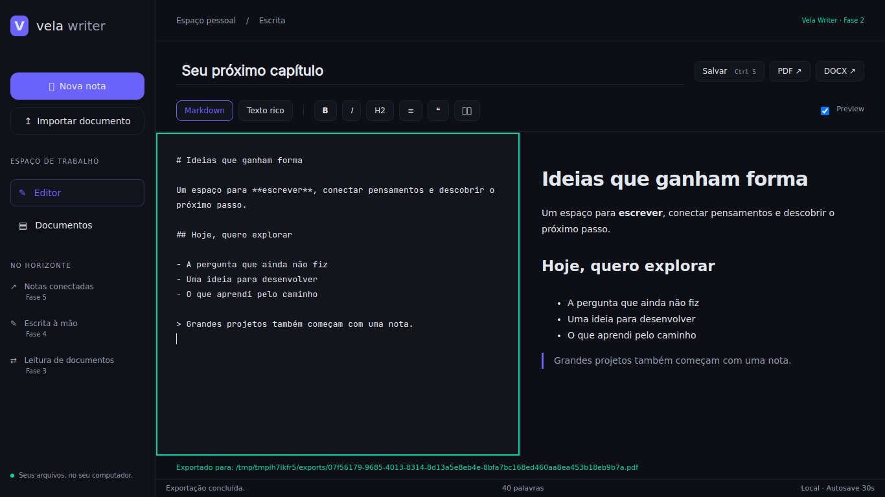

# Vela Writer

Aplicação desktop open source para escrever em Markdown ou texto rico,
organizar documentos e exportar PDF/DOCX.

**Estado: Fases 1 e 2 implementadas.** Python 3.10+, Vela Framework,
Bottle, pywebview e PyQt5. Interface pt-BR e recursos locais.



## Instalar e executar

Requer Python 3.10+, Git e uma sessão gráfica.

```bash
git clone https://github.com/zxlawdx/open-doc.git
cd open-doc
python -m venv .venv
```

Windows / PowerShell:

```powershell
.\.venv\Scripts\Activate.ps1
python -m pip install -r requirements.txt
python manage.py collectstatic --no-tailwind
python manage.py runapp
```

Linux / Mint:

```bash
source .venv/bin/activate
python -m pip install -r requirements.txt
python manage.py collectstatic --no-tailwind
python manage.py runapp
```

`python main.py` usa o mesmo bootstrap Vela. O runtime seleciona Qt/PyQt5.
No Linux, o QtWebEngine precisa das bibliotecas gráficas da distribuição,
incluindo Xtst, NSS, X11, xkbcommon, EGL e áudio. Instale o pacote correspondente
se um import informar biblioteca ausente. Não execute o desktop como root.

A instalação inicial baixa dependências; depois, fontes, preview e estilos
funcionam offline. Node só é necessário para recompilar CSS e testar JavaScript.

## Integração real com Vela

O projeto segue o ciclo de vida do framework:

1. `manage.py` delega ao `vela.cli.commands.CommandRunner`.
2. `config/wsgi.py` constrói `VelaApp` com `config.settings`.
3. `VelaApp.register_app("apps.writer")` descobre views e API.
4. `register_routes` registra a tela no router visual.
5. `vela.template_engine.engine.render_template` renderiza a composição.
6. `WriterBridge` estende `BaseBridge`, preservando navegação e eventos.
7. `VelaApp.run()` controla servidor, shell e janela desktop.

Não há instanciação manual de janela ou servidor em `main.py`.
O layout `blank` permite à aplicação ocupar toda a área útil do shell.
O bundle offline inclui as classes do próprio shell Vela.
O framework permanece uma dependência, fixada em uma revisão inspecionada.

Os fontes visuais ficam em `ui/`. `tools/sync_frontend.py` os prepara em
`apps/writer/static/` e executa o collectstatic oficial do Vela, produzindo
`staticfiles/writer/`. As cópias geradas não são versionadas.

## Editor — Fase 2

- Criar, renomear, listar e reabrir notas.
- Restaurar a última nota ao reiniciar.
- Markdown com preview ao vivo por marked.js local.
- Texto rico com títulos, negrito, itálico, listas, citações e código.
- Alternância entre modos; Markdown é o formato canônico.
- Salvamento manual por botão ou Ctrl+S / Cmd+S.
- Formatação por Ctrl+B / Cmd+B e Ctrl+I / Cmd+I.
- Autosave a cada 30 segundos enquanto houver alterações.
- SQLite transacional com revisões para impedir sobrescrita concorrente.
- Recuperação de alterações após pausa de digitação de 600 ms.
- Em conflitos, preservação do buffer e opção de salvar uma cópia.
- Confirmação nativa de fechamento quando há alterações pendentes.
- Exportação da revisão salva para PDF e DOCX em `~/VelaWriter/exports/`.

A recuperação usa SQLite e não depende de manter a mesma porta HTTP.
Um cache adicional do WebView reduz a janela de perda durante a mesma sessão.
Fechar à força durante a última pausa de 600 ms ainda pode perder as teclas
mais recentes. Ctrl+S aguarda a persistência do conteúdo atual.

O preview usa DOMPurify. Imagens externas não são carregadas.
Os exportadores preservam títulos, formatação básica, listas, citações,
código e tabelas. Referências a imagens viram texto alternativo; HTML bruto
é tratado como texto. Não há promessa de fidelidade de um processador Word.
A fonte PDF embutida cobre português e caracteres latinos; scripts como CJK
e conjuntos completos de emoji exigem fontes adicionais.

## Biblioteca — Fase 1

Importa cópias de PDF, DOCX, PPTX, Markdown e TXT UTF-8 por seletor nativo.
Os originais são preservados. Colisões recebem nomes exclusivos.
PDF e Office têm validação básica de assinatura/estrutura.
Markdown e TXT importados podem ser abertos como novas notas editáveis.
Leitura visual de PDF/DOCX/PPTX continua na Fase 3.

## Dados locais

```text
~/VelaWriter/
├── documents/
│   ├── docx/
│   ├── pptx/
│   └── pdf/
├── notes/                 # Markdown e TXT importados
├── drawings/
├── exports/
└── .veladata/
    ├── settings.json      # preferências, gravadas atomicamente
    └── writer.sqlite3     # notas, sessão, revisões e recuperação
```

As notas criadas no editor são persistidas no SQLite. Para backup, feche o
aplicativo e copie a pasta VelaWriter inteira. A API escuta apenas em
127.0.0.1 e exige token da bridge para alterações.

## Desenvolvimento e testes

```bash
python -m pip install -r requirements-dev.txt
npm ci
python -m pytest -q
node --test tests/editor.test.cjs
python -m black --check --line-length 88 app apps config tools tests main.py manage.py
node --check ui/static/js/app.js
node --check ui/static/js/editor.js
```

Recompilar Tailwind e sincronizar:

```bash
python tools/build_css.py
python manage.py collectstatic --no-tailwind
```

O CSS compilado já está versionado; não é necessário Node para executar.

## Validação

- **23 testes Python**: persistência, revisões concorrentes, recuperação,
  integração VelaApp/BaseBridge, shell offline, API e exportações relidas.
- **10 testes JavaScript**: preview seguro, modo rico, tabelas, autosave,
  conflitos, edição durante salvamento e limpeza do lifecycle.
- **Qt/PyQt5 real no Linux, em modo offscreen**: inicialização pelo VelaApp,
  preview, salvamento, alternância para texto rico, exportação PDF e
  encerramento da janela verificados.
- Layout no QtWebEngine verificado em **1366×768, 1600×900 e 1920×1080**,
  sem overflow horizontal. Capturas em `docs/images/`.
- Windows e seletor nativo interativo ainda precisam de teste físico.

A compatibilidade com Chromium do QtWebEngine 5.15 inclui fallback para
Array.at usado pelo marked.js e altura viewport sem depender de unidades dvh.

## Organização

| Caminho | Responsabilidade |
| --- | --- |
| `manage.py`, `main.py` | Entradas para o runtime oficial Vela. |
| `config/settings.py`, `config/wsgi.py` | Configuração e registro de apps. |
| `apps/writer/views.py`, `apps/writer/api.py` | Descoberta de telas e endpoints. |
| `app/bridge.py` | Extensão da bridge e recursos nativos. |
| `app/router.py` | View Vela e decorators da API. |
| `app/editor.py` | Documentos, revisões, sessão e recuperação. |
| `app/runtime.py` | Serviços compartilhados. |
| `app/config.py` | Workspace e preferências. |
| `app/file_organizer.py` | Validação e importação por tipo. |
| `app/exporters/` | Interpretação Markdown e exportação PDF/DOCX. |
| `ui/templates/` | Composição do editor e navegação. |
| `ui/static/js/editor.js` | Edição, preview, autosave e recuperação. |
| `ui/static/js/app.js` | Bootstrap e lifecycle de página Vela. |
| `ui/static/js/vendor/` | Bibliotecas locais e licenças. |
| `ui/static/css/main.css` | Tema e Tailwind compilado. |
| `ui/static/fonts/` | Fontes locais WOFF2/TTF e licenças. |
| `tools/` | Build CSS e sincronização de estáticos. |
| `tests/` | Testes Python e JavaScript. |
| `docs/CONTRIBUTING.md` | Guia de contribuição. |

## Próximas fases

3. Leitura e conversão de PDF, DOCX e PPTX.
4. Canvas com pressão de caneta e PDF multipágina.
5. Notas conectadas, FTS5 e grafo de conhecimento.
6. Empacotamento e polimento.

## Licenças

Código original da aplicação: MIT. Vela Framework: MPL-2.0.
Inter e JetBrains Mono: SIL OFL, com licenças incluídas.
marked.js e Turndown: MIT. DOMPurify: licença dual Apache-2.0/MPL-2.0.
As licenças dos fornecedores são mantidas junto aos arquivos locais.

Veja [CONTRIBUTING](docs/CONTRIBUTING.md).
