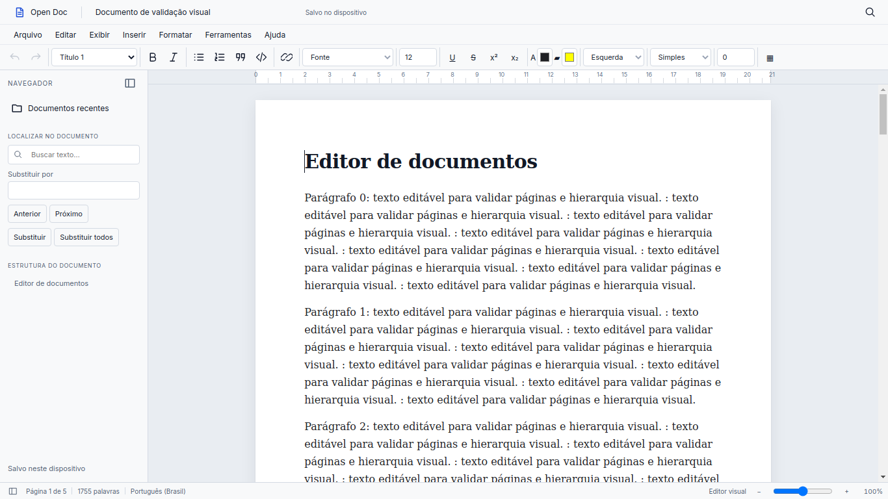

# Open Doc

O Open Doc é um aplicativo desktop de código aberto para escrever documentos,
ler e anotar PDFs, montar apresentações e trabalhar com planilhas e dados. Os arquivos de trabalho ficam no
computador. O uso cotidiano dispensa conta e sincronização em nuvem.

O projeto usa o [Vela Framework](https://github.com/zxlawdx/Vela-framework),
desenvolvido pelo mesmo autor. O Vela integra o backend Python à interface
HTML, CSS e JavaScript exibida em uma janela pywebview.



## O que já dá para fazer

| Área | Recursos |
| --- | --- |
| Biblioteca | Barra lateral com Página inicial, Recentes e Arquivos importados. Busca por título, filtros por formato e atalhos para criar ou importar arquivos. |
| Documentos | Criar ou editar DOCX, formatar texto e parágrafos, configurar páginas, trabalhar com tabelas, importar dados CSV ou TSV e inserir expressões matemáticas. A calculadora insere resultados como texto editável. |
| Tinta digital | Caneta, marca-texto livre, borracha parcial, remoção de traço inteiro e conversão opcional de manuscrito com um reconhecedor local. |
| PDFs | Navegar, buscar, destacar, comentar, adicionar notas adesivas, extrair páginas e exportar cópias anotadas. PDFs digitais compatíveis também permitem substituir trechos de texto e salvar uma cópia corrigida. |
| Apresentações | Criar ou importar PPTX, organizar slides, inserir texto, formas e imagens, criar gráficos editáveis, aplicar transições, apresentar em tela cheia e exportar um slide ou a apresentação inteira. |
| Planilhas e Dados | Editar planilhas XLSX, importar CSV/TSV, usar fórmulas e tabelas dinâmicas, consultar dados com SQL e preparar cadernos de código. |
| Código | Editor Python e SQL com completamento. A execução Python roda em processo separado com as permissões do usuário e requer a versão iniciada pelo interpretador. |

A edição de texto em PDF é experimental e depende da fonte e da composição do
arquivo. OCR, digitalização e edição visual de imagens em PDF seguem pendentes.
Arquivos DOCX e PPTX com layouts ou efeitos complexos podem apresentar diferenças
na importação ou na exportação. Para um panorama técnico, veja
[Layout e limites](#layout-e-limites).

## Instalar e executar

Baixe a versão para seu sistema na página de [Releases](https://github.com/zxlawdx/open-doc/releases).

- **Windows x64.** Execute o instalador `Setup.exe` ou extraia o ZIP portátil inteiro e abra `Open-Doc.exe`.
- **Ubuntu e Linux Mint x64.** Instale o arquivo `.deb` com `sudo apt install ./nome-do-arquivo.deb`. O arquivo `.tar.gz` contém a versão portátil e o instalador de atalho.
- **Fedora x64.** Use o `.tar.gz`, extraia o pacote completo e execute `Open-Doc/Open-Doc` ou `Open-Doc/Instalar.sh`. O `.deb` é destinado a sistemas Debian/Ubuntu. O pacote portátil requer as bibliotecas gráficas do sistema (X11/XWayland, XCB, Mesa, NSS, ALSA e Fontconfig).

### Gerar uma release Windows e Linux x64

O workflow **Open Doc Windows and Linux packages** gera os seguintes downloads:

- **Setup.exe** instala para o usuário atual, com assistente em português,
  atalho no menu Iniciar, opção de atalho na área de trabalho e desinstalador.
- **Portable.zip** contém o executável e as dependências do aplicativo. Extraia
  o ZIP inteiro e abra `Open-Doc/Open-Doc.exe`.
- **Linux-amd64.deb** instala o Open Doc no Ubuntu, Linux Mint e outras
  distribuicoes Debian x86-64: use `sudo apt install ./Open-Doc-<versao>-Linux-amd64.deb`.
  O aplicativo fica disponivel no menu e pelo comando `open-doc`.
- **Linux-x64.tar.gz** contém o executável `Open-Doc/Open-Doc` e o script
  `Open-Doc/Instalar.sh` para criar um atalho no menu do usuário. O build usa
  Ubuntu 22.04 x64 como base de compatibilidade (Linux Mint 21 ou mais recente).

Em **Actions**, execute o workflow manualmente para gerar artefatos de teste.
Após integrar a versão desejada à `main`, envie uma tag `vMAJOR.MINOR.PATCH`
para criar uma release com os pacotes dos dois sistemas e seus checksums SHA-256.
A publicação exige o smoke test do executável em ambientes limpos Ubuntu 22.04, Ubuntu 24.04 e Fedora com X11. Isso não certifica todos os drivers e GPUs físicos.
Em sessões Wayland com XWayland disponível, o runtime prefere `xcb`; uma escolha explícita de `QT_QPA_PLATFORM` é preservada.

Para complementar uma release existente que só tenha Windows, execute o
workflow pela `main` e preencha **linux_release_tag** com a tag da release.
O job compila o código dessa tag e acrescenta os arquivos Linux após os testes.

```bash
git switch main
git pull --ff-only
git tag -a v1.0.1 -m "Open Doc 1.0.1 - Windows e Linux"
git push origin v1.0.1
```

O Vela empacota Python, Qt e os arquivos da interface usados pelo aplicativo.
O pacote não exige uma instalação prévia de Python ou Node.js. A execução de
scripts Python em Planilhas e Dados ainda requer iniciar o Open Doc pelo
interpretador, e as funções que usam LibreOffice dependem de sua instalação
separada. Os pacotes são gerados sem assinatura Authenticode.

### Executar pelo código-fonte

Tenha Git, Python 3.11 ou mais recente, Node.js 22 ou mais recente com npm e
uma sessão gráfica. O CI usa Python 3.12 e Node.js 22 no Windows e no Linux.
O primeiro preparo baixa as dependências. O aplicativo usa os recursos
compilados localmente.

**Windows (PowerShell)**

```powershell
git clone https://github.com/zxlawdx/open-doc.git
cd open-doc
python -m venv .venv
.\.venv\Scripts\Activate.ps1
python -m pip install --upgrade "pip>=26.2"
python -m pip install -r requirements.txt
python manage.py collectstatic --yes
python manage.py runapp
```

**Linux (Bash)**

```bash
git clone https://github.com/zxlawdx/open-doc.git
cd open-doc
python3 -m venv .venv
source .venv/bin/activate
python -m pip install --upgrade "pip>=26.2"
python -m pip install -r requirements.txt
python manage.py collectstatic --yes
python manage.py runapp
```

No Linux, o QtWebEngine depende de bibliotecas gráficas do sistema, incluindo
Xtst, NSS, X11, xkbcommon, EGL e áudio. Para atualizar um clone na branch
`main`, execute `git pull --ff-only origin main` e repita a instalação das
dependências e o `collectstatic` antes de abrir o aplicativo. Em clones anteriores
à separação do CSS, o primeiro pull pode exigir guardar uma alteração já
existente em `apps/open_doc/static/css/main.css` usando `git stash push --
apps/open_doc/static/css/main.css`. Nas versões seguintes, compilar o CSS
não deve modificar esse arquivo rastreado.

### Executar sem Node.js (computador corporativo)

Se o Windows não permite instalar Node/npm, o **runtime do Open Doc pode ser
preparado com o Python e o Vela já instalados**. Execute na raiz do projeto:

```powershell
git pull --ff-only origin main
python tools/offline_assets.py prepare
python manage.py runapp
```

O comando offline valida SHA-256 dos bundles JS versionados, reaproveita o
Tailwind já compilado no repositório, atualiza os estilos próprios do editor
(inclusive as anotações PDF) e chama o coletor de estáticos **oficial do
Vela**, sem executar Node/npm. Não é um servidor alternativo e não exige
direitos administrativos nem conexão CDN. O arquivo CSS gerado é atualizado
localmente; não execute `collectstatic` novamente sem Node.

**Limitação:** esse modo reaproveita utilitários Tailwind e bibliotecas
pré-compilados. Para alterar dependências JavaScript ou gerar novas classes
Tailwind, use o fluxo de build normal em uma máquina autorizada com Node.
Não é uma forma de contornar políticas corporativas de execução.

O comando `collectstatic` verifica as dependências Node do projeto. A opção
`--yes` autoriza o `npm ci` quando necessário. Use `--no-install` para
impedir essa instalação automática. `python main.py` usa o mesmo bootstrap
do Vela.

### Abrir PDF, DOCX e PPTX pelo sistema

Depois de instalar a versão empacotada pelo Vela, abra o Open Doc uma vez.
Ele registra os três formatos em **Abrir com**, sem alterar a escolha atual
do usuário. Para mudar a preferência, use **Arquivo → Aplicativo padrão…**.

- **Windows:** o menu abre Configurações → Aplicativos padrão. Pesquise
  `.pdf`, `.docx` ou `.pptx` e escolha **Open Doc** para cada extensão.
- **Linux:** escolha um formato no menu e confirme. O sistema usa `xdg-mime`
  (pacote `xdg-utils`). Também é possível escolher pelo **Abrir com** do
  gerenciador de arquivos.

O arquivo recebido do sistema abre como uma cópia de trabalho, da mesma forma
que **Abrir / importar**. Para testar a abertura com um clone já preparado,
execute `python main.py "caminho/para/arquivo.docx"`. O menu de associações é
destinado à versão instalada. Uma instalação anterior precisa ser atualizada
com um novo build para receber o recurso.

### Restaurar apenas um slide

Em uma apresentação editável, abra **Arquivo → Histórico de versões**,
selecione uma versão e clique em **Comparar**. Escolha o número do slide
para ver o resumo de conteúdo daquela posição nas duas versões. Confira o
conteúdo e use **Restaurar este slide**. A operação mantém os demais slides
e guarda o estado completo anterior como um ponto de recuperação.

## Recursos em detalhe

- Criar, renomear, reabrir e listar documentos recentes a partir do SQLite.
- Editor visual estruturado; Markdown e preview em Exibir. Em documentos ricos, o Markdown é uma representação simplificada somente para leitura.
- Títulos, negrito, itálico, listas, citações, código e links HTTP/HTTPS/mailto.
- Seleção preservada na toolbar; desfazer/refazer com histórico limitado.
- Salvamento manual, Ctrl+S e autosave a cada 30 segundos.
- Revisões transacionais, conflitos sem sobrescrita e salvar como cópia.
- Recuperação SQLite após pausa de digitação de 600 ms e cache auxiliar local.
- Importar DOCX abre imediatamente na folha editável, com pacote original preservado.
- PDF local com texto selecionável, busca, marcadores, miniaturas e renderização sob demanda. Comentários e destaques vinculados ao texto ficam no painel lateral.
- Tinta vetorial compartilhada em DOCX/PDF/PPTX: caneta, marca-texto, borracha de traço, histórico e recuperação.
- Reconhecimento local opcional de escrita com revisão antes de inserir texto na fonte escolhida.
- Leitor PPTX local independente de LibreOffice. Apresentações compatíveis podem ser editadas e exportadas com texto, formas, imagens, gráficos e transições.
- Fontes disponíveis no sistema, tamanho 1–512 pt, sublinhado, tachado, sobrescrito/subscrito, cores, alinhamento, espaçamento e recuo.
- Tabelas com modelos e tamanho configurável, importação de CSV ou TSV, navegação por Tab, edição de linhas e colunas, mescla horizontal e divisão.
- Equações como texto Unicode editável, com paleta de símbolos, prévia e calculadora. Equações estruturadas do Word (OMML) ficam fora desse fluxo.
- Exportar PDF, DOCX, HTML e Markdown pelo diálogo nativo **Salvar como**, com gravação atômica.
- Importar fontes TTF/OTF/TTC locais, aplicar sem reiniciar e gerenciar o catálogo importado.
- Páginas editáveis, quebra com Ctrl+Enter, página em branco e configuração de tamanho/orientação/margens.
- Renomear, duplicar e excluir documentos internos na Home, com confirmação de exclusão.
- Outline de títulos navegável; localizar/substituir com Ctrl+F/Ctrl+H.
- Zoom por contexto com Ctrl++, Ctrl+−, Ctrl+0 e Ctrl+roda. A engrenagem da Central e dos editores abre os temas Claro, Escuro e Automático.
- Confirmação nativa de fechamento se houver alterações pendentes.

Ctrl+N cria, Ctrl+O importa, Ctrl+F localiza, Ctrl+B e Ctrl+I formatam,
Ctrl+Z desfaz, Ctrl+Y ou Ctrl+Shift+Z refaz. Copiar, colar, recortar e selecionar
usam os atalhos do sistema. Menus têm navegação por setas, Escape e foco visível.

Detalhes de instalação opcional, escrita, PDF/PPTX, licenças e testes em
[PDF e tinta](docs/OPEN_DOC_PDF_INK.md).
Estabilização, diagnóstico e evidências em [Estabilização](docs/OPEN_DOC_STABILIZATION.md).

## Layout e limites

Documentos começam no modo **Com páginas**, usando A4 para documentos nativos e
as dimensões/margens das seções do DOCX. O layout distribui os nós editáveis entre
folhas, fragmentando parágrafos longos e tabelas entre linhas. Quebras automáticas
não são gravadas no modelo. Exibir > Fluxo contínuo muda somente a visualização.
Clique direito na margem ou no intervalo das folhas abre as ações de página.
O dark mode mantém as folhas brancas. A paginação é aproximada, sem equivalência
pixel a pixel ao Word. Tabelas com mesclas verticais e objetos maiores que uma folha
podem exceder a área de conteúdo; o conteúdo permanece acessível.

Documentos ricos usam o modelo canônico `opendoc-rich-v1`, validado em JSON.
Markdown legado continua abrindo; sua cópia original é mantida na primeira
conversão para rico. Fonte ausente mantém seu nome e usa fallback visual.

A exportação DOCX atualiza o corpo e as relações necessárias sobre uma cópia do
pacote original. Partes desconhecidas, estilos, temas, imagens e cabeçalhos/rodapés
não editados são preservados. Elementos opacos aparecem identificados na tela.
Cabeçalho/rodapé têm preview de leitura; campos Word não são recalculados.
Imagens flutuantes, estilos condicionais de tabela e layout complexo podem ser
aproximados, com avisos de compatibilidade. Não há promessa de 100% Word.

PDF e Markdown ricos usam um adapter simplificado, com aviso de perdas; HTML
preserva parte da tipografia, mas também tem layout aproximado. Colagem continua
em texto simples. Não são executados macros, HTML altChunk ou downloads externos.
Busca é literal e mostra até 30 resultados navegáveis.

## Dados e migração segura

O diretório padrão é `~/OpenDoc/`, com `documents/`, `notes/`, `drawings/`,
`exports/` e `.veladata/`. O banco mantém o nome físico `writer.sqlite3` por
compatibilidade: ele contém documentos, sessão ativa, revisões e recuperação.
Preferências ficam em `.veladata/settings.json`.
DOCX original e mídia ficam em `.veladata/packages/<id>/`; inclua essa pasta no backup.
A migration aditiva inclui conteúdo rico e origem tanto em documents quanto em recovery,
sem apagar Markdown anterior. `legacy_backups` guarda a versão anterior à promoção.

Se existe `~/VelaWriter/` e `~/OpenDoc/` ainda não existe, a aplicação copia os
dados e usa a API de backup SQLite para preservar conteúdo commitado em WAL.
**O diretório antigo não é removido.** Se ambos existem, usa OpenDoc sem mesclar
ou sobrescrever; registre/resolva a migração antes de remover qualquer backup.
Resultado em `.veladata/migration.json`. Falhas não publicam workspace parcial;
links simbólicos no legado exigem cópia manual dos dados sem links.

O cache aceita temporariamente a chave antiga `vela-writer-recovery:` e migra
para `open-doc-recovery:`. A recuperação SQLite não depende da porta escolhida
pelo Vela. Forçar encerramento nos últimos 600 ms pode perder as teclas mais
recentes; Ctrl+S aguarda a persistência atual. Para backup, feche o app e copie
OpenDoc inteiro. A API é local e exige token para alterações.

## Arquitetura Vela

`config/wsgi.py` é o composition entrypoint: configura um `ApplicationContext` e então monta o `VelaApp`. `apps/open_doc/application/document_application.py` é a facade de casos de uso compartilhada por HTTP e WebView; `api.py` cuida apenas da boundary HTTP e `bridge.py` dos diálogos/capacidades nativas. Regras de documento ficam fora dessas boundaries.

A estrutura segue `presentation -> application -> domain -> infrastructure`. O domínio não importa Vela/Bottle/WebView; política de filesystem fica em `infrastructure/workspace.py`. O Vela fixado pelo projeto honra `API.max_body_size` nativamente, então não há mais mutação de `Bottle.BaseRequest` no Open Doc.

Veja [docs/ARCHITECTURE.md](docs/ARCHITECTURE.md) para o fluxo de dependências, boundaries e pontos de migração. O antigo `services.container` permanece como shim durante a migração incremental. `manage.py` usa diretamente o CommandRunner oficial e propaga seus exit codes; `launcher.py` entra no mesmo `config.wsgi.run()` de `main.py`. `collectstatic` é o único entrypoint de preparação de assets do código-fonte.

## Desenvolvimento e validação

```powershell
python -m pip install -r requirements-dev.txt
python manage.py collectstatic
python -m pytest -q
npm test
python tools/audit_css.py
python -m black --check --line-length 88 apps config tools tests main.py manage.py launcher.py
node --check apps/open_doc/static/js/app.js
python manage.py runapp
```

Em CI use `python manage.py collectstatic --yes` para autorizar explicitamente a instalação local via `npm ci`. CSS e vendors do app permanecem locais/offline; o runtime de uma distribuição já compilada usa apenas Python/Qt.
`python tools/qa_desktop.py` executa smoke test com workspace temporário e
capturas reais pelo QtWebEngine; requer Node 22+ para CDP local. Nunca exponha
a porta de debugging no uso normal. O script usa a janela criada pelo VelaApp.

A validação cobre serviços de exportação/fontes, persistência, round-trip DOCX,
modelo, edição e paginação, além do Vela/Qt real. O QA substitui somente
a escolha dos seletores nativos, mantendo bridge, SQLite, HTTP e editor reais.
Resultados por plataforma estão no [relatório de estabilização](docs/OPEN_DOC_STABILIZATION.md).
Interação física com os seletores de arquivo e mesa digitalizadora não é comprovada
pelos testes automáticos. O [relatório da migração](docs/OPEN_DOC_VELA_PHASE2.md)
registra o estado anterior.

## Styles

Os fontes em `apps/open_doc/styles` separam tokens, layout, componentes, conteúdo,
estados e política responsiva. Edite esses fontes e rode `python manage.py collectstatic`.
O hook `tools.build_css:main` recompila Tailwind e combina o bundle com os estilos escritos à mão antes da coleta. O CSS de execução `runtime.css` é gerado localmente e ignorado pelo Git, evitando que `collectstatic` bloqueie o próximo `git pull`. O `main.css` versionado permanece somente como base Tailwind para o preparo offline; não o edite diretamente.
A toolbar usa grupos e scroll horizontal nas janelas menores; as páginas preservam
as dimensões lógicas. `python tools/qa_styles.py` captura a matriz visual no Qt real.

## Documentação

- [Arquitetura e boundaries](docs/ARCHITECTURE.md)
- [Sistema visual, responsividade e capturas Qt](docs/OPEN_DOC_STYLES.md)
- [Integração Vela, fase 2, exportação, fontes e páginas](docs/OPEN_DOC_VELA_PHASE2.md)
- [DOCX rico: modelo, preservação, testes e limites](docs/OPEN_DOC_RICH_DOCX.md)
- [Auditoria integral e roteiro de validação](docs/auditoria/AUDITORIA_INTEGRAL.md)
- [Baseline histórico](docs/OPEN_DOC_AUDIT.md)
- [Pesquisa de referências](docs/EDITOR_REFERENCE_RESEARCH.md)
- [Decisão do engine](docs/EDITOR_ENGINE_DECISION.md)
- [Redesign, matriz de regressão e capturas](docs/OPEN_DOC_REDESIGN.md)
- [Contribuição](docs/CONTRIBUTING.md) e [relato de bugs](https://github.com/zxlawdx/open-doc/issues/new)

## Licenças

Aplicação MIT; Vela MPL-2.0. Inter/JetBrains Mono SIL OFL. marked/Turndown MIT;
DOMPurify Apache-2.0/MPL-2.0. Licenças preservadas junto aos vendors.
Nenhum código de ONLYOFFICE/WebODF/engines pesquisados foi incorporado.

Correção de teclado, tinta e undo local: [relatório e evidências](docs/OPEN_DOC_INPUT_STABILITY.md).

### Imagens no editor DOCX

Use **Inserir → Imagem…** ou o botão de imagem na barra. São aceitos PNG, JPEG e WebP até 4 MB (16 milhões de pixels e até 8.000 pixels por dimensão). Fotografias com orientação EXIF são normalizadas; WebP é convertido para PNG para exportação Word.

Clique na imagem para selecioná-la. Arraste para posicionar livremente na página ou levá-la a outra página; a imagem fica à frente do texto. A alça no canto inferior direito redimensiona proporcionalmente. Setas movem, Alt + setas redimensionam e Shift aumenta o passo para 10 pontos. Delete/Backspace excluem. Cada gesto pode ser desfeito e refeito com Ctrl+Z/Ctrl+Y.

As imagens ficam separadas dos snapshots de texto e são deduplicadas por conteúdo. Salvar, reabrir e exportar DOCX preserva os objetos nativos `wp:anchor`, suas coordenadas, dimensões e mídia. O PDF simplificado continua tendo as limitações de fidelidade descritas pelo diálogo de exportação.


### Editar apresentações importadas

PPTX importados abrem no editor de slides com seleção e edição de objetos,
edição de textos e tabelas, histórico e exportação para PPTX. Objetos especiais
mantêm sua representação original e suas partes OOXML; isso preserva recursos
que o editor ainda não tem um painel próprio para configurar. Não significa
paridade integral com todas as funções do PowerPoint.

Arquivos já importados no modo antigo são convertidos ao abrir, preservando o
original, as anotações e a recuperação. Clique numa miniatura e use as setas,
Page Up/Down ou Home/End para navegar. No slide, as setas movem o objeto
selecionado. Use **Apresentar**, **F5** (desde o início), **Shift+F5** (slide atual)
e **Esc** para encerrar a apresentação.

### Edição unificada e modelos acadêmicos

A [matriz de compatibilidade](docs/OFFICE_COMPATIBILITY.md) descreve DOCX, PDF, XLSX, CSV, TSV, PPTX, ODT e ODP, os novos comandos e modelos acadêmicos e os recursos ainda pendentes. ODT/ODP usam conversão opcional pelo LibreOffice, com revisão de fidelidade. Veja também o [benchmark real de 300 a 100 mil traços](docs/OFFICE_PERFORMANCE.md).
