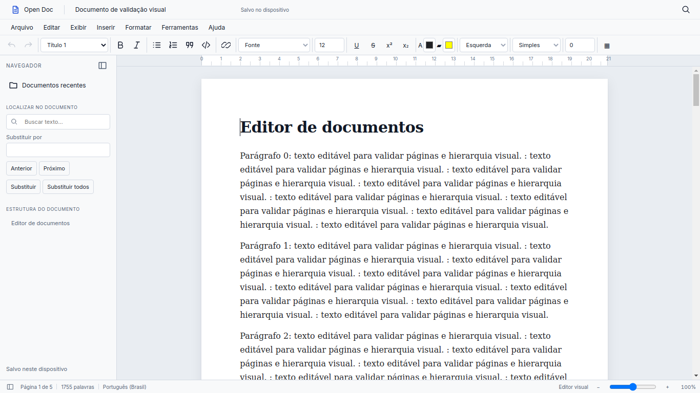

# Open Doc

Open Doc é um editor de documentos desktop local-first construído com o Vela Framework.
O editor visual abre numa folha branca, com menus clássicos, estrutura de títulos,
busca local e ferramentas de formatação. Sem conta, nuvem ou CDN.



## Executar

Requer Python 3.10+, Git, dependências Qt e uma sessão gráfica. No primeiro build do código-fonte, Node 22+ compila o CSS offline do shell Vela.

```powershell
git clone https://github.com/zxlawdx/open-doc.git
cd open-doc
python -m venv .venv
.\.venv\Scripts\Activate.ps1
python -m pip install -r requirements.txt
npm ci
python tools/build_css.py
python manage.py collectstatic
python manage.py runapp
```

Para atualizar um clone existente, use `git pull origin main` antes de instalar.
No Linux/Mint, ative com `source .venv/bin/activate`. QtWebEngine precisa das
bibliotecas gráficas do sistema (Xtst, NSS, X11, xkbcommon, EGL e áudio).
`python main.py` usa o mesmo bootstrap oficial Vela.

## Recursos reais

- Criar, renomear, reabrir e listar documentos recentes a partir do SQLite.
- Editor visual estruturado; Markdown e preview em Exibir. Em documentos ricos, o Markdown é uma representação simplificada somente para leitura.
- Títulos, negrito, itálico, listas, citações, código e links HTTP/HTTPS/mailto.
- Seleção preservada na toolbar; desfazer/refazer com histórico limitado.
- Salvamento manual, Ctrl+S e autosave a cada 30 segundos.
- Revisões transacionais, conflitos sem sobrescrita e salvar como cópia.
- Recuperação SQLite após pausa de digitação de 600 ms e cache auxiliar local.
- Importar DOCX abre imediatamente na folha editável, com pacote original preservado.
- Biblioteca com capabilities do backend; PDF local com texto selecionável, busca, marcadores, miniaturas e renderização sob demanda.
- Tinta vetorial compartilhada em DOCX/PDF/PPTX: caneta, marca-texto, borracha de traço, histórico e recuperação.
- Reconhecimento local opcional de escrita com revisão antes de inserir texto na fonte escolhida.
- PPTX anotável com prévia fiel via LibreOffice opcional e exportação de texto nativo.
- Fontes disponíveis no sistema, tamanho 1–512 pt, sublinhado, tachado, sobrescrito/subscrito, cores, alinhamento, espaçamento e recuo.
- Tabelas com tamanho configurável, navegação por Tab, inserção/exclusão de linhas e colunas, mescla horizontal e divisão.
- Exportar PDF, DOCX, HTML e Markdown pelo diálogo nativo **Salvar como**, com gravação atômica.
- Importar fontes TTF/OTF/TTC locais, aplicar sem reiniciar e gerenciar o catálogo importado.
- Páginas editáveis, quebra com Ctrl+Enter, página em branco e configuração de tamanho/orientação/margens.
- Renomear, duplicar e excluir documentos internos na Home, com confirmação de exclusão.
- Outline de títulos navegável; localizar/substituir com Ctrl+F/Ctrl+H.
- Zoom real entre 50% e 150%, régua informativa e temas claro/escuro/sistema.
- Confirmação nativa de fechamento se houver alterações pendentes.

Ctrl+N cria, Ctrl+O importa, Ctrl+F localiza, Ctrl+B e Ctrl+I formatam,
Ctrl+Z desfaz, Ctrl+Y ou Ctrl+Shift+Z refaz. Copiar, colar, recortar e selecionar
usam os atalhos do sistema. Menus têm navegação por setas, Escape e foco visível.

Detalhes de instalação opcional, escrita, PDF/PPTX, licenças e testes em
[PDF e tinta](docs/OPEN_DOC_PDF_INK.md).

## Layout e limites

Documentos começam no modo **Com páginas**, usando A4 para documentos nativos e
as dimensões/margens das seções do DOCX. O layout distribui os nós editáveis entre
folhas, fragmentando parágrafos longos e tabelas entre linhas. Quebras automáticas
não são gravadas no modelo. Exibir > Fluxo contínuo muda somente a visualização.
Clique direito na margem ou no intervalo das folhas abre as ações de página.
O dark mode mantém as folhas brancas. A paginação é aproximada, sem equivalência
pixel a pixel ao Word. Tabelas com mesclas verticais e objetos maiores que uma folha
podem exceder a área de conteúdo; o conteúdo permanece acessível.

Documentos ricos usam o modelo canônico `opendoc-rich-v1`, validado em JSON.
Markdown legado continua abrindo; sua cópia original é mantida na primeira
conversão para rico. Fonte ausente mantém seu nome e usa fallback visual.

A exportação DOCX atualiza o corpo e as relações necessárias sobre uma cópia do
pacote original. Partes desconhecidas, estilos, temas, imagens e cabeçalhos/rodapés
não editados são preservados. Elementos opacos aparecem identificados na tela.
Cabeçalho/rodapé têm preview de leitura; campos Word não são recalculados.
Imagens flutuantes, estilos condicionais de tabela e layout complexo podem ser
aproximados, com avisos de compatibilidade. Não há promessa de 100% Word.

PDF e Markdown ricos usam um adapter simplificado, com aviso de perdas; HTML
preserva parte da tipografia, mas também tem layout aproximado. Colagem continua
em texto simples. Não são executados macros, HTML altChunk ou downloads externos.
Busca é literal e mostra até 30 resultados navegáveis.

## Dados e migração segura

O diretório padrão é `~/OpenDoc/`, com `documents/`, `notes/`, `drawings/`,
`exports/` e `.veladata/`. O banco mantém o nome físico `writer.sqlite3` por
compatibilidade: ele contém documentos, sessão ativa, revisões e recuperação.
Preferências ficam em `.veladata/settings.json`.
DOCX original e mídia ficam em `.veladata/packages/<id>/`; inclua essa pasta no backup.
A migration aditiva inclui conteúdo rico e origem tanto em documents quanto em recovery,
sem apagar Markdown anterior. `legacy_backups` guarda a versão anterior à promoção.

Se existe `~/VelaWriter/` e `~/OpenDoc/` ainda não existe, a aplicação copia os
dados e usa a API de backup SQLite para preservar conteúdo commitado em WAL.
**O diretório antigo não é removido.** Se ambos existem, usa OpenDoc sem mesclar
ou sobrescrever; registre/resolva a migração antes de remover qualquer backup.
Resultado em `.veladata/migration.json`. Falhas não publicam workspace parcial;
links simbólicos no legado exigem cópia manual dos dados sem links.

O cache aceita temporariamente a chave antiga `vela-writer-recovery:` e migra
para `open-doc-recovery:`. A recuperação SQLite não depende da porta escolhida
pelo Vela. Forçar encerramento nos últimos 600 ms pode perder as teclas mais
recentes; Ctrl+S aguarda a persistência atual. Para backup, feche o app e copie
OpenDoc inteiro. A API é local e exige token para alterações.

## Arquitetura Vela

`manage.py` delega ao CommandRunner do framework. `config/wsgi.py` instancia
VelaApp com `config.settings`, registra `apps.open_doc`, descobre views/API e
executa o lifecycle oficial. OpenDocBridge estende BaseBridge. Templates usam
`render_template` do Vela e layout blank, ocupando toda a WebView.

Todo runtime do produto está em `apps/open_doc/`: views, API, bridge, services,
modelo, parsers, exporters, templates e estáticos. As antigas pastas `app/`, `ui/`
e `tools/sync_frontend.py` foram removidas. Não há servidor ou janela paralela.
`manage.py` usa diretamente o CommandRunner oficial; `launcher.py` entra no mesmo
`config.wsgi.run()` de `main.py`. `collectstatic` é o único coletor de assets.
O CSS do Open Doc está no namespace `open_doc`; o bundle do shell é gerado pelo
pipeline oficial do framework. Após o primeiro build, `collectstatic --no-tailwind`
serve para atualizar os assets sem recompilar o shell. Distribuições precisam incluir
`staticfiles` produzido no build.

## Desenvolvimento e validação

```powershell
python -m pip install -r requirements-dev.txt
npm ci
python -m pytest -q
npm test
python tools/audit_css.py
python -m black --check --line-length 88 apps config tools tests main.py manage.py launcher.py
node --check apps/open_doc/static/js/app.js
python tools/build_css.py
python manage.py collectstatic --no-tailwind
python manage.py runapp
```

CSS e vendors do app estão versionados. O primeiro build do shell Vela exige Node; o runtime de uma distribuição já compilada usa apenas Python/Qt.
`python tools/qa_desktop.py` executa smoke test com workspace temporário e
capturas reais pelo QtWebEngine; requer Node 22+ para CDP local. Nunca exponha
a porta de debugging no uso normal. O script usa a janela criada pelo VelaApp.

A validação cobre serviços de exportação/fontes, persistência, round-trip DOCX,
modelo, edição e paginação, além do Vela/Qt real no Linux. O QA substitui somente
a escolha dos seletores nativos, mantendo bridge, SQLite, HTTP e editor reais.
Windows e a interação física com o popup do Windows exigem validação nessa plataforma.
Veja [o relatório desta migração](docs/OPEN_DOC_VELA_PHASE2.md).

## Styles

Os fontes em `apps/open_doc/styles` separam tokens, layout, componentes, conteúdo,
estados e política responsiva. Edite esses fontes e rode `python tools/build_css.py`
seguido de `python manage.py collectstatic --no-tailwind`. O arquivo main.css é gerado.
A toolbar usa grupos e scroll horizontal nas janelas menores; as páginas preservam
as dimensões lógicas. `python tools/qa_styles.py` captura a matriz visual no Qt real.

## Documentação

- [Sistema visual, responsividade e capturas Qt](docs/OPEN_DOC_STYLES.md)
- [Integração Vela, fase 2, exportação, fontes e páginas](docs/OPEN_DOC_VELA_PHASE2.md)
- [DOCX rico: modelo, preservação, testes e limites](docs/OPEN_DOC_RICH_DOCX.md)

- [Auditoria e baseline](docs/OPEN_DOC_AUDIT.md)
- [Pesquisa de referências](docs/EDITOR_REFERENCE_RESEARCH.md)
- [Decisão do engine](docs/EDITOR_ENGINE_DECISION.md)
- [Redesign, matriz de regressão e capturas](docs/OPEN_DOC_REDESIGN.md)
- [Contribuição](docs/CONTRIBUTING.md)

## Licenças

Aplicação MIT; Vela MPL-2.0. Inter/JetBrains Mono SIL OFL. marked/Turndown MIT;
DOMPurify Apache-2.0/MPL-2.0. Licenças preservadas junto aos vendors.
Nenhum código de ONLYOFFICE/WebODF/engines pesquisados foi incorporado.
