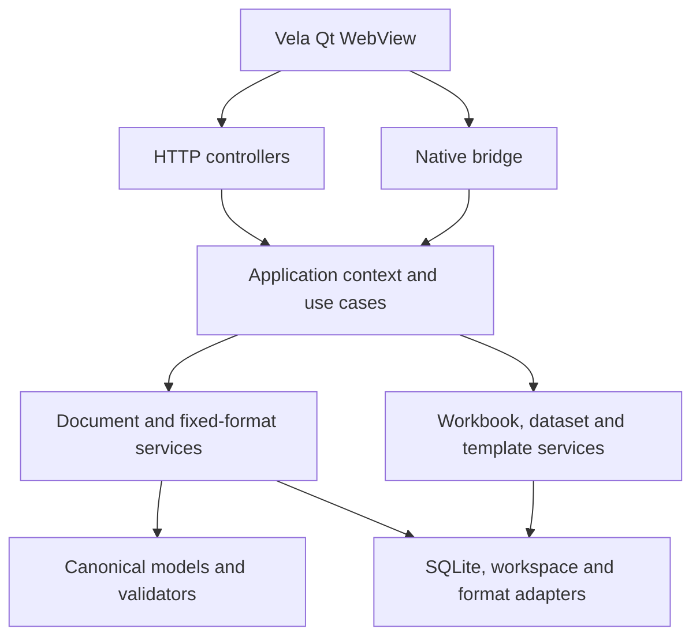

# Open Doc architecture

## Composition root

`config/wsgi.py` configures one `ApplicationContext` and then creates `VelaApp`. It does not import Bottle or contain document business rules.

The pinned Vela revision natively consumes `API["max_body_size"]`, so Open Doc no longer mutates `Bottle.BaseRequest.MEMFILE_MAX` and no transport-compatibility adapter is required.

## Asset composition

`config/settings.py` declares the project-specific asset pipeline through `ASSETS`. `python manage.py collectstatic` is the single preparation entrypoint: it validates Node/npm, offers to install missing project-local npm dependencies, runs the vendor build, invokes `tools.build_css:main`, collects app static files and writes the SHA-256 manifest.

Node/npm remain system prerequisites and are never installed by Vela. In CI the same path is authorized explicitly with `collectstatic --yes`.

## Thin boundaries

`bridge.py` owns native UI concerns such as file pickers and delegates document operations to `DocumentApplication`. `api.py` owns HTTP session authentication and status mapping. Document commands delegate to the same facade. Workbook and dataset controllers currently dispatch into their dedicated services. The composition root publishes its context only after the stores initialize.

The historical `config.composition` path remains as a compatibility shim while existing services/tests migrate to `config.composition`.

## Domain and document model

The domain must not import Vela, Bottle or WebView. The existing `document_model/` package remains the production serialization model; new framework-independent value objects live under `domain/`. Migration is incremental to avoid breaking DOCX/PDF round trips.

## Infrastructure

Filesystem path policy is centralized in `infrastructure/workspace.py`. Import/export implementations remain technology adapters and may depend on filesystem, PDF/DOCX libraries and OS capabilities. Framework-version workarounds should live at this boundary only when they are still required.

## Frontend contracts

`app.js` owns lifecycle, routing and bridge access. The editor facade in
`document_kinds.js` routes rich and fixed formats to their own adapters. Sheets
and datasets share grid interaction and the Python/SQL editor while retaining
different persistence models. `zoom.js` routes shared controls to the visible
surface. `theme.js` and the semantic CSS tokens apply appearance across modules.
The persisted document representations stay independent of both preferences.

## Tests

`tests/integration/test_architecture.py` validates dependency direction with AST import scanning and asserts the declarative `collectstatic` asset contract. Existing DOCX round-trip, fixed document, handwriting and frontend tests remain the behavioral safety net.
