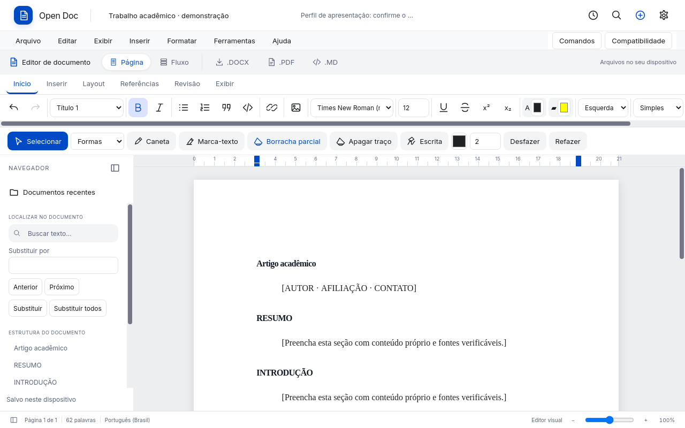
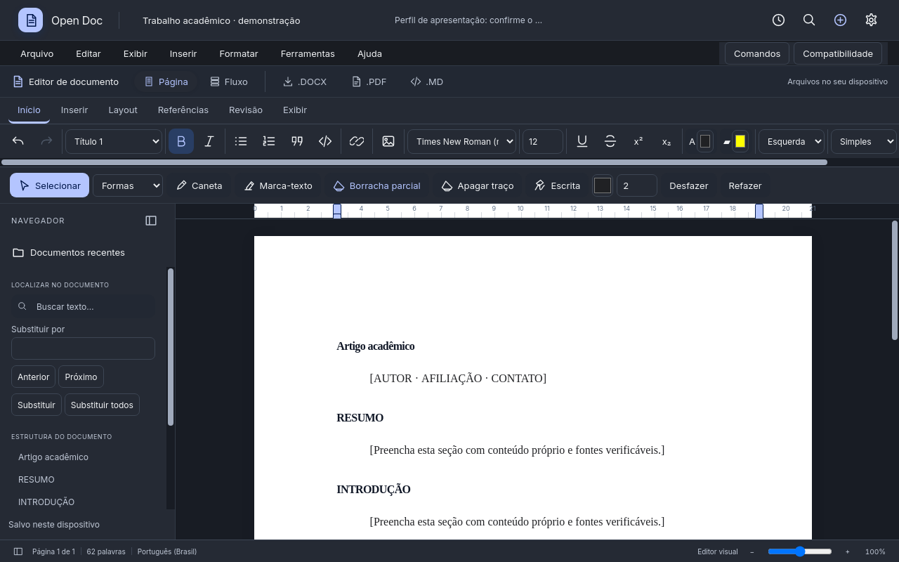
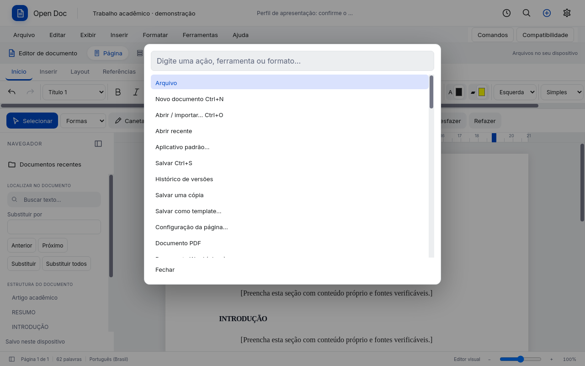
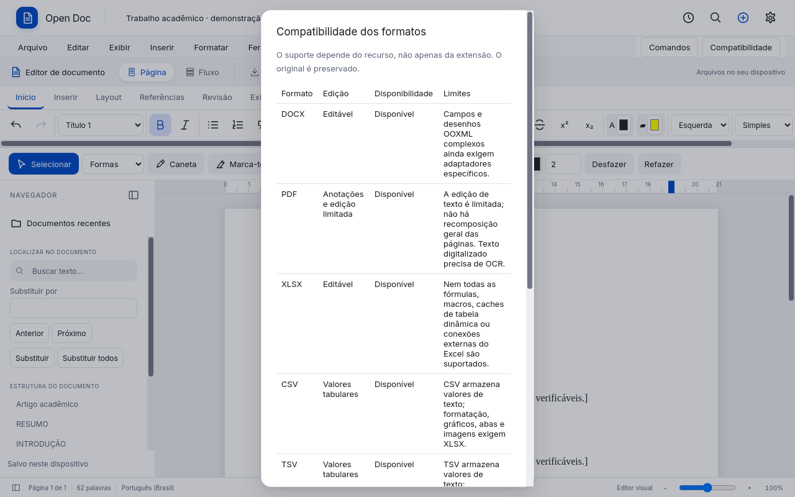

# Edição unificada e compatibilidade

Estado desta implementação, 13/11/2026. Este documento descreve recursos verificáveis e lacunas; não declara paridade integral com Microsoft Office, Google Workspace ou LibreOffice.

## Organização do monólito

- `office/capabilities.py`: contrato explícito dos oito formatos, disponibilizado pelo bootstrap e pelo painel **Compatibilidade**.
- `office/opendocument.py`: adaptador opcional de conversão ODT/ODP, separado dos modelos e serviços existentes.
- `office/academic.py`: perfis de apresentação e modelos acadêmicos originais.
- `DocumentApplication`: casos de uso de importação/exportação; não se cria um segundo armazenamento de documentos.
- `office_workspace.js`: descoberta de comandos e abas contextuais. Os editores de texto, páginas fixas e planilhas conservam seus modelos próprios.
- `ink_engine.js`: geometria, índice espacial, cache de caminhos e pintura cooperativa, sem persistência ou dependência do DOM.
- `recovery.js` / `persistence_worker.js`: canais separados por editor; geometria grande é enviada em lotes de 256 traços para evitar uma única clonagem síncrona gigante.

## Formatos

| Formato | Abertura e edição | Exportação | Limites relevantes |
|---|---|---|---|
| DOCX | Texto estruturado, estilos, tabelas, imagens, equações, páginas, tinta | DOCX, PDF, HTML, Markdown, ODT opcional | Campos OOXML, desenhos e documentos complexos exigem revisão; não há editor completo de todos os objetos Word |
| PDF | Visualização, pesquisa, anotações, tinta, extração de páginas e substituição textual limitada | PDF | Não é um processador de texto com recomposição arbitrária; digitalização exige OCR |
| XLSX | Grade, fórmulas suportadas, dimensões, mesclas, congelamento, imagens, gráficos, formas, controles e pivot | XLSX, CSV, TSV | Sem paridade com todas as fórmulas, VBA, conexões e caches de pivot do Excel |
| CSV | Grade editável e operações tabulares | CSV, TSV, XLSX | Texto delimitado não armazena estilos, várias abas, imagens ou gráficos; use XLSX para esses recursos |
| TSV | Mesma edição tabular; tabulação como delimitador | TSV, CSV, XLSX | Mesmas limitações do CSV |
| PPTX | Modelo de slides editável, texto, tabelas, imagens, formas, navegação e apresentação | PPTX, ODP opcional | Objetos especiais podem ser preservados sem painel completo de edição; efeitos e recursos avançados exigem revisão |
| ODT | Conversão para DOCX e abertura no editor de texto | ODT, DOCX, PDF, HTML, Markdown | Requer LibreOffice; conversão não é preservação nativa sem perdas |
| ODP | Conversão para PPTX e abertura no editor de slides | ODP, PPTX | Requer LibreOffice; revisar fontes, mestres, efeitos e gráficos |

O arquivo importado original é preservado. Arquivos externos de planilha agora também passam pela entrada geral **Importar**, em vez de depender exclusivamente do seletor de planilhas.

### Instalar o conversor opcional

```bash
# Mint / Ubuntu
sudo apt install libreoffice-writer libreoffice-impress
# Fedora
sudo dnf install libreoffice-writer libreoffice-impress
```

No Windows, instale o LibreOffice normalmente. Também é possível configurar `OPEN_DOC_LIBREOFFICE` com o caminho do executável `soffice`. O painel informa quando a dependência está ausente. Os pacotes Open Doc não incorporam uma segunda suíte Office.

A conversão usa processo sem shell, perfil temporário isolado, macros com segurança elevada, timeout e publicação atômica. O preflight rejeita pacotes criptografados, caminhos inválidos e recursos incorporados por referência externa. Links textuais comuns continuam permitidos. Conversão indisponível ou inválida não sobrescreve o original nem um destino anterior.

## Ferramentas e modelos

1. No texto, use **Início, Inserir, Layout, Referências, Revisão e Exibir**. Os botões acionam comandos existentes do editor, sem duplicar sua lógica.
2. **Comandos** ou **Ctrl+Shift+P** pesquisa ações com ou sem acentos. Setas escolhem, Enter executa e Esc fecha; o foco permanece no diálogo enquanto ele está aberto.
3. Arraste os marcadores da régua para mudar as margens e o recuo de primeira linha. As setas ajustam 0,1 cm; Shift+seta, 1 cm. Há commit ao soltar, cancelamento com pointercancel e persistência no modelo de página/parágrafo.
4. Em **Referências**, aplique a base acadêmica ao documento, citação longa à seleção ou apresentação visual das referências. É possível editar depois.
5. Em **Formas**, escolha retângulo, elipse, linha ou seta e arraste sobre a página. São geometria de anotação com histórico, borracha e exportação; no DOCX, a tinta exportada é uma imagem, não um objeto de desenho Word editável.
6. Os novos modelos originais são trabalho acadêmico, projeto de pesquisa, artigo, fichamento, defesa, seminário, orçamento de pesquisa, avaliações e experimento. Não reproduzem templates proprietários de outros aplicativos.

### ABNT e revisão acadêmica

A base usa A4, margens superior/esquerda de 3 cm e inferior/direita de 2 cm, fonte Times New Roman 12 e espaçamento 1,5. O recuo de primeira linha de 1,25 cm e a apresentação de citação longa são convenções editáveis; o manual da instituição prevalece. Aplicar o perfil não gera citações corretas nem certifica conformidade ABNT. Bibliografia, referências cruzadas, sumário automático e paginação pré-textual continuam exigindo trabalho específico.

## Inventário de lacunas pesquisadas

A presença de um arquivo ou botão não comprova suporte completo. Esta é a comparação funcional para orientar próximos adaptadores, sem marcar pendências como entregues.

| Área | Disponível / ampliado aqui | Ainda requer implementação ou compatibilidade adicional |
|---|---|---|
| Texto e estilos | Formatação de caracteres/parágrafos, títulos, listas, tabelas, equações, imagens; perfis acadêmicos | Catálogo completo de estilos de usuário, estilos vinculados e compatibilidade exata com todos os temas Word |
| Revisão | Busca, substituição, desfazer/refazer e histórico local | Controle de alterações com aceitar/rejeitar, comparação de documentos e colaboração simultânea |
| Referências | Hierarquia de títulos e modelos acadêmicos | Sumário dinâmico com campos e páginas, índices de figuras, citações/bibliografia automáticas, referências cruzadas e mala direta |
| Página | Paginação, configuração, régua e quebras | Editor completo de todas as variações de cabeçalho/rodapé, seções complexas, colunas e paginação acadêmica pré-textual |
| Desenho | Tinta e quatro geometrias em páginas; formas nativas nos slides/planilhas já existentes | Editor vetorial Word completo, conectores inteligentes, diagramas e equivalência SmartArt |
| Células | Seleção, redimensionamento por cabeçalho, ajuste aos dados, estilos, fórmulas do motor, mesclas e congelamento | Matrizes dinâmicas completas, referências estruturadas e funções nomeadas equivalentes ao Excel/Sheets |
| Análise | Ordenação, filtros, tabelas dinâmicas e gráficos suportados | Modelo de dados/OLAP, segmentações plenamente interoperáveis, Power Query e pivots nativas com cache preservado |
| Controles de planilha | Imagens, gráficos, formas, validação e controles existentes | Todos os gráficos, controles ActiveX, macros e funcionalidades específicas de versões do Excel |
| Apresentação | Slides importados editáveis, texto, imagens, tabelas, formas, apresentação e teclado | Editor integral de mestres, animações, transições, objetos OLE/SmartArt e multimídia de todas as origens |
| PDF | Anotações, pesquisa, tinta, páginas e edição textual limitada | Edição geral de layout, OCR integral, assinatura digital e formulários completos |
| OpenDocument | Adaptador de importação/exportação com revisão explícita | Modelo ODF nativo e garantia de round-trip sem perdas para documentos arbitrários |
| Desempenho | Canvas visível em lotes, índice espacial, cache de Path2D, histórico sem JSON de geometria e transporte em lotes | Persistência incremental binária/por página, menos custo de abrir/gravar modelos extremos e índices construídos fora da interface |
| Acessibilidade | Rótulos, tabulação, diálogo com foco contido, teclado nas abas e régua | Auditoria completa com leitores de tela e testes de hardware em todas as plataformas |

## Fontes e decisões

Consultas a documentação primária em 13/11/2026; interface própria, sem copiar marcas, ícones ou assets proprietários.

- [Word: régua](https://support.microsoft.com/en-us/word/using-the-ruler-in-word) e [estilos](https://support.microsoft.com/en-us/word/customize-or-create-new-styles): margens/recuos e estilos como operações do modelo.
- [LibreOffice Writer: guia](https://books.libreoffice.org/en/GS262/GS26202-GettingStartedWithWriter.html) e [controle de alterações](https://help.libreoffice.org/latest/en-US/text/swriter/track_changes_toolbar.html): distinguir histórico local de revisão editorial.
- [LibreOffice: parâmetros de execução](https://help.libreoffice.org/latest/pt-BR/text/shared/guide/start_parameters.html): conversão e perfil separado.
- [Google Sheets: pivot](https://support.google.com/docs/answer/1272900?hl=en-419) e [segmentações](https://support.google.com/docs/answer/9245556?hl=en-419): distinguir pivot tabular atual de dashboard e cache nativo.
- [Excel: segmentações](https://support.microsoft.com/en-us/excel/get-started/use-slicers-to-filter-data) e [matrizes dinâmicas](https://support.microsoft.com/en-us/excel/dynamic-array-formulas-and-spilled-array-behavior): recursos ainda não equivalentes no motor local.
- [Fluent 2: toolbar](https://fluent2.microsoft.design/components/web/react/core/toolbar/usage) e [Windows: command bar](https://learn.microsoft.com/en-us/windows/apps/design/controls/command-bar): grupos funcionais, nomes visíveis, contexto e overflow.
- [W3C Pointer Events](https://www.w3.org/TR/pointerevents/): eventos de caneta, captura/cancelamento e amostragem.
- [Xournal++: desempenho com traços](https://github.com/xournalpp/xournalpp/issues/4662): motivação para medir volume de geometria, não apenas tamanho do arquivo. A implementação usa APIs do navegador, sem incorporar código desse projeto.
- [UFES: normalização](https://biblioteca.ufes.br/normalizacao) e [manual institucional UDESC](https://www.udesc.br/arquivos/udesc/id_cpmenu/9731/MANUAL_ESCRITA_UDESC_07_2025_17540643936632_9731.pdf): normas vigentes e necessidade de seguir o manual institucional; os modelos são um ponto de partida.

## Validação

`pytest`, `npm test`, conversões reais ODT/ODP quando LibreOffice está instalado e `tools/qa_office_foundation.py` com QtWebEngine. Os testes cobrem oito entradas de formato, arquivos originais intactos, falha atômica, pacotes inválidos, comandos, foco, índice espacial, cancelamento, histórico e montagem concorrente dos lotes no worker. O teste real verifica régua, perfil acadêmico, busca sem acentos, compatibilidade e persistência/reabertura de todos os traços. Veja [benchmark](OFFICE_PERFORMANCE.md).

Capturas reais do Qt, com documentos demonstrativos:





