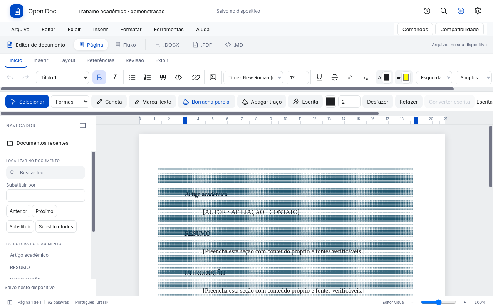

# Geometria e navegação: medição real no Qt

13/11/2026, Linux de desenvolvimento em container, Python 3.12, PyQt5/QtWebEngine, X11 virtual e renderização por software. Resultado local, não uma garantia de tempo em qualquer equipamento. As amostras são sintéticas: dois pontos de caneta e quatro vértices de contorno por traço, distribuídos pela primeira página. Não representam 100 mil traços de complexidade arbitrária nem hardware de mesa digitalizadora.

## Medição

O roteiro cria 300, 500, 1.000, 10.000 e 100.000 traços, registra a edição no editor real, espera a pintura, inicia a gravação e imediatamente abre uma planilha pelo fluxo da aplicação. Depois verifica o documento persistido e reabre pela biblioteca. Todos os traços foram preservados, sem redução da quantidade como estratégia de desempenho.

| Traços | Registro no histórico/modelo | Índice espacial inicial | Consulta espacial | Troca para planilha durante gravação | Gravação completa |
|---:|---:|---:|---:|---:|---:|
| 300 | 1,91 ms | 2,16 ms | 0,185 ms | 139,63 ms | 53,61 ms |
| 500 | 1,58 ms | 1,92 ms | 0,040 ms | 88,89 ms | 45,97 ms |
| 1.000 | 2,45 ms | 7,29 ms | 0,045 ms | 67,77 ms | 122,20 ms |
| 10.000 | 4,40 ms | 30,14 ms | 0,085 ms | 55,57 ms | 608,32 ms |
| 100.000 | 30,54 ms | 66,82 ms | 0,090 ms | 49,05 ms | 9.936,51 ms |

A primeira planilha também inclui o carregamento inicial dos módulos. A coluna de gravação mede `editor.flush()` de ponta a ponta: transmissão ao worker, servidor e confirmação. A reabertura é verificada separadamente, sem incluir seu tempo nessa coluna. Não confundir a consulta espacial de 0,09 ms com a edição ou a aplicação inteira em 0,1 ms.

Antes de retirar a serialização de geometria do orçamento de histórico, o mesmo cenário de 100 mil traços consumia **1.328,9 ms** apenas no registro da edição; na medição acima, **30,5 ms**. Execuções diferentes e cargas concorrentes variam: isso comprova a remoção de trabalho pesado desse caminho, não é um benchmark de laboratório com distribuição estatística.

## Estratégias implementadas

- Índice espacial em grade para rejeitar traços distantes da borracha; objetos extensos ficam em uma lista separada. O teste verifica que nenhum candidato real é omitido e que a ordem de pintura se mantém.
- Cache fraco por objeto imutável para limites e Path2D, sem reter documentos fechados por referências globais fortes.
- Canvas nas páginas visíveis; os vetores originais permanecem no modelo e na exportação. Com 100 mil traços havia **zero paths SVG por traço** na página rasterizada.
- Pintura cooperativa com orçamento alvo de 6 ms por lote, cancelável quando a página é ocultada, substituída ou desmontada. O orçamento é cooperativo: uma operação individual, GC ou agendamento pode excedê-lo.
- Orçamento de histórico calculado pela geometria e referências compartilhadas, sem JSON de todos os pontos a cada edição. O limite do histórico remove estados antigos; não remove traços do documento.
- Envio de grandes camadas ao worker em lotes de 256 traços, montagem no worker e descarte dos lotes após a operação. Canais de documento, planilha e dados são independentes.
- Pixel budget do canvas limita memória de renderização e não o conteúdo. Cancelar uma pintura não altera o documento.

## Limitações medidas

Com 100 mil traços, a pintura completa levou aproximadamente **937 ms** em 50 quadros; a maior fatia observada foi **13,4 ms**, apesar do alvo de 6 ms. O maior intervalo entre quadros durante construção, indexação e pintura foi **283 ms**. A construção inicial do índice ainda é síncrona. Abrir e gravar o modelo inteiro continuam operações proporcionais ao volume de dados; a persistência completa desse teste levou cerca de 10 segundos, embora a navegação tenha ocorrido antes de sua conclusão.

Não existe garantia de 0,1 ms para toda a interface. Persistência incremental por página/geometria e índices construídos fora da interface são próximos passos concretos. A ampliação dos limites de validação para 128 MB e 8 milhões de pontos mantém verificações explícitas de recurso, finitude e integridade; não se corta silenciosamente um traço ao atingir 20 mil amostras na interface.

## Reprodução

```bash
python manage.py collectstatic --yes
QT_API=pyqt5 QT_QPA_PLATFORM=xcb \
  OPEN_DOC_QA_OUTPUT=docs/images/office-foundation \
  python tools/qa_office_foundation.py
```

Use uma sessão gráfica disponível e o runtime Vela fixado em `requirements.txt`. Em ambiente de CI configure Xvfb/Qt conforme os workflows existentes. Os testes locais deste relatório executaram sem sandbox Chromium por exigência do container de QA; essa configuração não é orientação para desativar proteções no computador do usuário.

`OPEN_DOC_STRESS_COUNTS=300,500,1000,10000,100000` define os cenários. O workflow Windows/Linux executa 300, 1.000 e 10.000; o relatório local inclui também 500 e 100.000. Não há asserção frágil de milissegundos em máquina compartilhada; há asserções de quantidade preservada, ausência de explosão de nós DOM, contrato de edição e reabertura.

[Dados da execução](images/office-foundation/stress.json).


