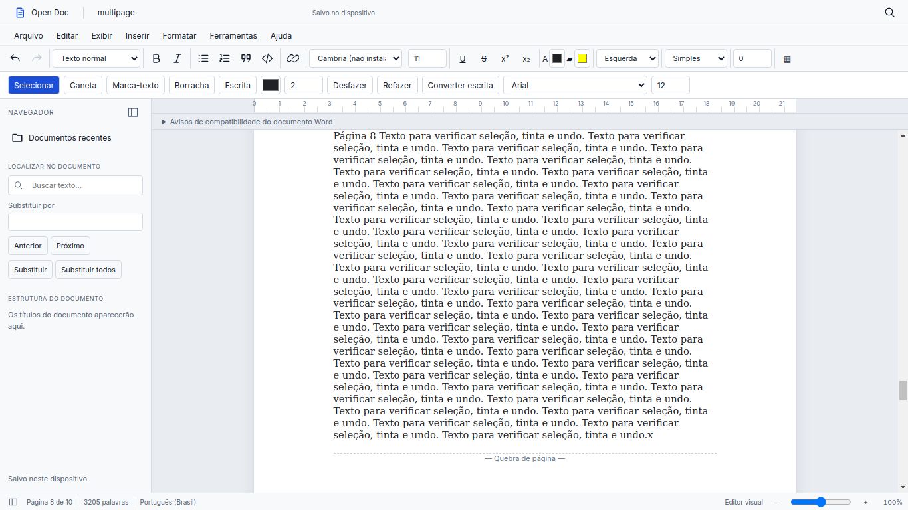
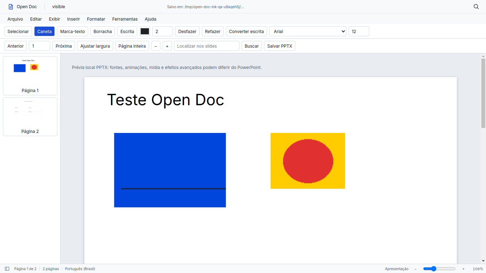
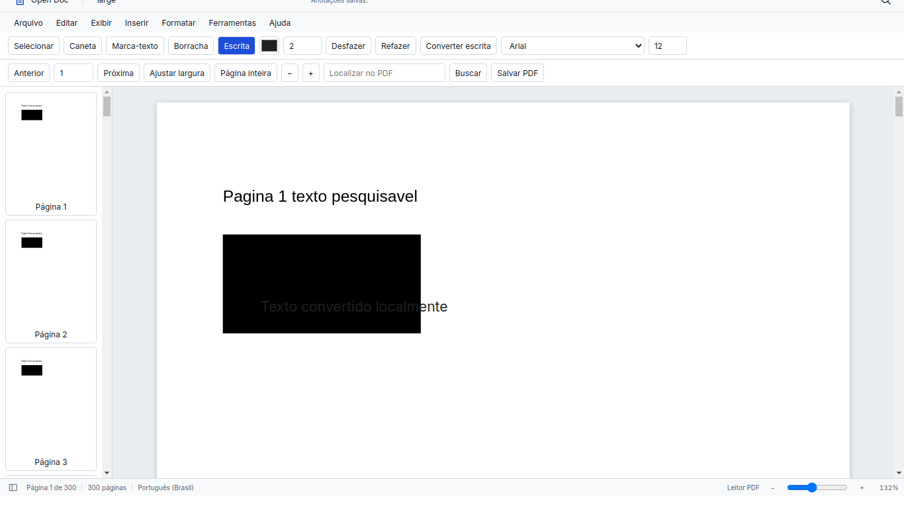
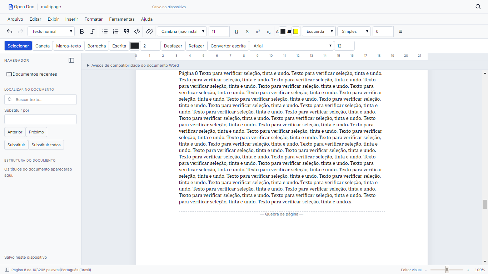
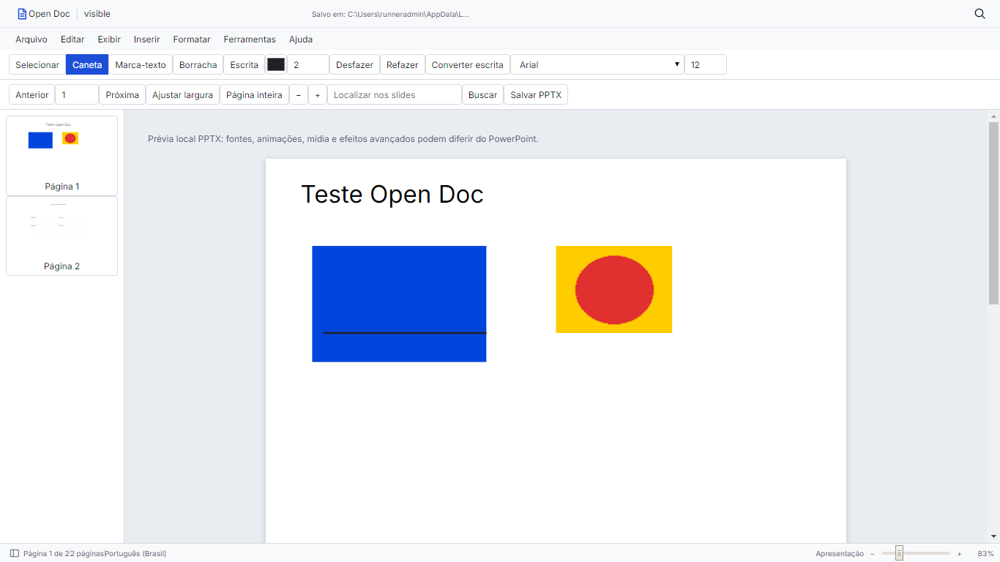

# Estabilização geral do Open Doc

HEAD inicial: `92dd01e5c7095311576b79ad8d713abe701e8e87` (`main`).
HEAD de código validado: `e2b13aed7c3f013fa0605fe041d776f89600bffd`.
O commit documental posterior acrescenta este relatório e as capturas, sem
alterar o código aprovado.
A implementação continua no Vela: `VelaApp`, `BaseBridge`, API local autenticada,
templates oficiais e collectstatic. Nenhum servidor de produto paralelo foi criado.
Esta entrega estabiliza os fluxos existentes; não redesenha o editor.

## Causas, mudanças e evidências

| Problema | Causa encontrada | Correção | Evidência reproduzível |
| --- | --- | --- | --- |
| Tinta DOCX desaparecia no Qt | Chamadas diretas a `structuredClone`, ausente no Chromium 87 | Clone JSON explícito para o modelo, independente dos efeitos colaterais de PDF.js | 20 traços com `window.structuredClone=undefined`, histórico, salvar/reabrir no Qt |
| Tinta causava repaginação | Commit de tinta seguia o caminho geral do editor | Evento específico de tinta; atualização de modelo, histórico, recuperação e overlay | Contadores de render completo e layout permanecem zero; nó da página preservado |
| Ctrl+Z reconstruía documento | Restauração sempre renderizava tudo; serialização normalizava blocos não editados | Serialização do bloco alterado; patch de parágrafos, invalidação a partir do bloco e preservação do scroll | Digitação/desfazer/refazer na página 8 preserva sete páginas anteriores; QTest na primeira/intermediária/última página |
| Link perdia seleção no diálogo | Paginação movia os nós enquanto o modal estava aberto | Bookmark explícito restaurado antes de inserir link | Diálogo aberto durante paginação pendente no JSDOM e toolbar nativa Qt |
| Desfazer formatação parecia não agir | execCommand emitia input e o adapter registrava a mesma operação novamente | Um registro por operação, com fallback somente quando não houve input nativo | Mouse real: negrito/desfazer/refazer; suíte de teclado/clipboard e rich DOCX |
| MD/TXT importava sem abrir | Ponte retornava apenas informações do arquivo | `Editor.import_note()` e retorno do documento aberto | UTF-8, emoji e arquivo >100 KB nos testes; Ctrl+O real e reabertura pela Home |
| Build falhava em caminhos Windows | Uso de pathname de URL como caminho nativo | `fileURLToPath`, `dirname`, `resolve` e `join` | Build em diretório com espaço e acento; execução Windows com caminho contendo espaço e acento |
| Assets antigos escondiam falha | Não havia validação do grupo gerado | Staging, sintaxe de quatro bundles, hashes, manifesto e marcador de falha | Rebuild propositalmente quebrado retorna erro e bloqueia grupo antigo |
| PDF podia ficar branco | Falha na camada de texto derrubava o canvas já renderizado | Estágios independentes de canvas, texto e links, erro visível e log contextual | Pixels escuros no Qt, worker real e fake worker; erro de TextLayer mantém canvas completo |
| PDF não permitia seleção | Regra universal do shell aplica user-select:none também aos spans | Regra explícita na camada de texto e descendentes | Seleção real de texto e busca da página 299 no Qt |
| PPTX dependia de conversor externo | Serviço exigia prévia PDF via LibreOffice | Renderer PPTX próprio, local e separado de PDF.js | Texto, imagem, forma e tabela no Qt; importação com subprocesso proibido; PDF.js deliberadamente indisponível durante abertura |
| Troca de formato deixava estado ativo | Recursos e tarefas assíncronas do leitor anterior sobreviviam | Cancelamento, epochs e limpeza ao desativar | DOCX → MD → TXT → PDF → PPTX → DOCX → Home → MD → novo na mesma janela |

A regressão ampla `tools/qa_desktop.py` também passou: remontagem Vela, seleção,
formatação, links, menus, fontes, tabelas, paginação, exportações, clipboard,
atalhos reais e layout claro/escuro em três resoluções.

O histórico continua limitado por snapshots. O patch cobre alterações locais em até
16 parágrafos com estrutura/seções e numeração preservadas. Mudanças estruturais,
tabelas e operações amplas conservam o fallback completo. Histórico por deltas é
uma evolução posterior; não é requisito para o caminho local já verificado.
Autosave, dirty, atualização de botões e commits de tinta não são eventos de layout.

## Build e diagnóstico

```powershell
python -m pip install -r requirements-dev.txt
python -m pip check
npm ci
npm run build
python tools/check_runtime_assets.py
python -m pytest -q
npm test
python manage.py runapp
```

O builder resolve as dependências antes de usá-las e orienta `npm ci` quando faltam.
Os quatro bundles são compilados para Chrome 83 (também compatíveis com 87)
em staging e passam por `node --check`. O manifesto registra versões, SHA-256 dos bundles e hash do builder
com o lockfile. É escrito por último, depois da substituição dos arquivos. Uma
falha/interrupção deixa `.build-failed`; o startup recusa esse grupo, mesmo que
existam bundles de uma compilação antiga. A publicação é validada como grupo;
não existe uma transação de filesystem que troque todos os arquivos simultaneamente.

O staging de vendors fica fora das pastas coletadas, impedindo a distribuição
acidental de um bundle temporário em caso de interrupção. O CSS do shell é
gerado pelo pipeline Vela em `staticfiles/css/vela.bundle.css`; esse arquivo
ativa o shell offline oficial e também é exigido no startup.

O bootstrap comunica o manifesto ao cliente; a versão estática é comparada antes
de iniciar os leitores. Os logs registram versão/hash/UA, e erros do PDF informam
etapa e página. CMaps, fontes, worker, renderer PPTX e licenças ficam locais.
`npm run build` também recompila CSS e executa collectstatic sem Tailwind implícito.

## Escolha do renderer PPTX

| Candidato avaliado | Licença / dependências | Decisão |
| --- | --- | --- |
| [mdurbar/pptx-viewer](https://github.com/mdurbar/pptx-viewer) | MIT; fflate; SVG e foreignObject | Escolhido e fixado em 0.2.2; código/ZIP locais e execução comprovada nos Qt/Chromium 83 e 87 |
| [loadfix/pptxjs](https://github.com/loadfix/pptxjs) | Pacote pptx-preview 0.1.0 Apache-2.0; JSZip e conversão EMF | Caminho adicional de metafiles e dependências; não integrado |
| [bowespublishing/pptx-browser](https://github.com/bowespublishing/pptx-browser) | MIT; descompressão nativa `DecompressionStream` | API exigida não comprovada neste Qt antigo; não integrado |
| [Pagus](https://github.com/pagus-kit/Pagus) | MIT; parser/renderer e dependências adicionais | Superfície maior e comportamento de fontes a controlar; não integrado |

O adapter sanitiza SVG/HTML, permite somente imagens locais/data/blob e remove
referências externas, scripts e conteúdo ativo. `foreignObject` permanece com seus
filhos sanitizados, necessário para texto e tabelas. Geometria SVG é preservada.
Slides, miniaturas e busca não dependem de PDF.js nem executam LibreOffice.
O módulo legado `readers/pptx/preview.py` permanece sem chamadas no fluxo ativo.

O pacote PPTX original é preservado byte a byte. python-pptx exporta tinta como
imagem transparente e texto reconhecido/revisado como caixas nativas. O endpoint
serve o MIME de apresentação correto. Recursos avançados, fontes ausentes,
animações e fidelidade idêntica ao PowerPoint não são garantidos; a interface
informa essa limitação. Exportação PDF de PPTX não é oferecida neste fluxo.

## Resultados locais

- Python: **85 aprovados, 1 ignorado** (integração opcional Windows Ink).
- JavaScript: **49 aprovados**, incluindo falha de rebuild e execução sem clone nativo.
- O DOCX privado fornecido também passou no Qt, com digitação/tinta/histórico
  na primeira, intermediária e última página, salvar/reabrir e original intacto.
  Ele não foi incluído no repositório, nos logs ou nas capturas. Para repetir,
  defina `OPEN_DOC_USER_FIXTURE` antes de executar `tools/qa_stabilization.py`.
- Vela/PyQt/QtWebEngine reais: DOCX com dez páginas importado de arquivo, 20 traços,
  salvar/reabrir, histórico incremental, atalhos QTest, importações e ciclo Home/novo.
- PDF real com 300 páginas: renderização limitada à região visível, fontes/CMaps
  locais, pixels não brancos, dois caminhos de worker, camada de texto com erro
  provocado sem perda do canvas e exportação com texto nativo.
- PPTX real de duas páginas: título, retângulo, imagem, tabela, tinta persistida e
  exportação PPTX; fonte original intacta; sem processo externo e sem PDF.js.
- Capturas sintéticas em 1366×768, 1600×900 e 1920×1080.

Ambiente efetivamente executado: Linux 6.18.44 x86_64, Python 3.12.14,
PyQt 5.15.11, Qt de compilação 5.15.14, PyQtWebEngine 5.15.7,
runtime QtWebEngine 5.15.19, Chromium **87.0.4280.144**, Node 24.19.0 e npm 11.9.0.
A UA completa é emitida por `tools/qa_runtime.py`. O Linux foi executado em
offscreen/software; o workflow Windows usa o plugin gráfico nativo `windows`
do Qt. O modo software e a
opção de sandbox dos testes são exclusivos do ambiente de QA, não configuração
nova da aplicação em produção. Eventos de caneta são sintéticos: não comprovam
mesa digitalizadora, pressão física, palma real ou reconhecedor do Windows.

## Windows

O runtime Windows efetivamente observado usa **QtWebEngine 5.15.2 / Chromium
83.0.4103.122**, mesmo com PyQtWebEngine 5.15.7. O Linux usa Chromium 87.
Por isso o alvo comum foi reduzido de Chrome 87 para **Chrome 83**; uma
compilação que passa no Node ou no Linux 87 não comprova compatibilidade Windows.

A [primeira execução real](https://github.com/zxlawdx/open-doc/actions/runs/38917225032)
compilou os vendors do zero (PDF.js 4.10.38, target Chrome 87), mas falhou depois
no CSS com `WinError 193`: o Vela fixado executava o shim POSIX do Tailwind.
`tools/build_css.py` mantém o pipeline oficial e adapta exclusivamente sua chamada
ao CLI para `node node_modules/tailwindcss/lib/cli.js` no Windows. A falha foi
registrada e corrigida; esse run não é considerado aprovação. A validação
subsequente também encontrou o CSS do shell fora do destino offline, um separador
de caminhos dependente do SO no auditor CSS e o plugin offscreen incompatível
com o serviço TSF do Windows. Esses problemas foram corrigidos. O QA passou a
usar o plugin gráfico nativo do Windows. Por fim, a regressão de fontes passou a
selecionar uma família existente no catálogo da plataforma, mantendo a verificação
do tamanho de 18 pt, persistência e exportação.

A [execução final Windows](https://github.com/zxlawdx/open-doc/actions/runs/38941778861)
foi **aprovada**, incluindo build limpo, ambas as suítes e os quatro QAs Vela/Qt.
O código validado é o HEAD indicado no início deste relatório. O build removeu
o bundle PDF antes de recompilar; o teste adicional de vendor executou também
num diretório com espaço e acento e provocou uma falha para verificar o bloqueio
de assets antigos.

| Ambiente real | Linux | Windows |
| --- | --- | --- |
| SO | Linux 6.18.44 x86_64 | Windows Server 2025, build 26100 |
| Python | 3.12.14 | 3.12.10 |
| PyQt | 5.15.11 | 5.15.11 |
| Qt compilação | 5.15.14 | 5.15.2 |
| QtWebEngine runtime | 5.15.19 | 5.15.2 |
| Chromium | 87.0.4280.144 | 83.0.4103.122 |
| Node / npm | 24.19.0 / 11.9.0 | 22.23.3 / 10.9.9 |
| pytest | 85 aprovados, 1 ignorado | 84 aprovados, 2 ignorados |
| JavaScript | 49 aprovados | 49 aprovados |
| QAs reais | DOCX, PDF, PPTX e desktop aprovados | DOCX, PDF, PPTX e desktop aprovados |

No Windows foram ignorados o arquivo privado não redistribuído e a integração
opcional Windows Ink. O arquivo privado foi exercitado separadamente no Linux,
inclusive no Qt real. Nenhum skip substitui a validação funcional dos formatos.

Comandos Windows efetivamente executados:

```powershell
python -m pip install -r requirements-dev.txt
python -m pip check
npm ci
Remove-Item apps/open_doc/static/js/vendor/pdf.bundle.js
npm run build
python tools/check_runtime_assets.py
python -m pytest -q
npm test
python -u tools/qa_stabilization.py
python -u tools/qa_ink.py
python -u tools/qa_pptx.py
python -u tools/qa_desktop.py
```

Trechos da saída original:

```text
No broken requirements found.
Open Doc vendors OK ... "pdfjs-dist":"4.10.38" ... "target":"chrome83"
84 passed, 2 skipped, 1 warning in 24.20s
# pass 49
# fail 0
QT_DOCX_20_STROKES_WITHOUT_STRUCTUREDCLONE_NO_FULL_RENDER_SAVE_REOPEN_OK
QT_PAGE8_TYPING_UNDO_REDO_PREFIX_SCROLL_PRESERVED_OK
QT_QTEST_CTRL_O_MD_TXT_PDF_PPTX_DOCX_HOME_NEW_LIFECYCLE_OK
QT_PDF_TEXT_SELECTION_AND_SEARCH_PAGE_299_OK
QT_PDF_FAKE_WORKER_LOCAL_BUNDLE_NONWHITE_PIXELS_OK
QT_TEXT_LAYER_FAILURE_KEEPS_RENDERED_CANVAS_OK
QT_PPTX_WITHOUT_LIBREOFFICE_INK_SAVE_REOPEN_EXPORT_OK
NATIVE_RICH_DOCX_IMPORT_FORMAT_TABLE_SAVE_EXPORT_OK
NATIVE_CTRL_ENTER_UNDO_REDO_FONT_IMPORT_APPLY_DOCX_OK
NATIVE_QA_COMPLETE
```

A saída preservada com versões, UA, hash e demais checkpoints está em
[windows-qt-2026-10-16.txt](evidence/windows-qt-2026-10-16.txt).
As capturas Windows nas três resoluções estão versionadas em
`docs/images/stabilization/windows/`. O [artefato original do CI](https://github.com/zxlawdx/open-doc/actions/runs/38941778861/artifacts/12063876715)
contém a mesma matriz. O hash de build Windows foi
`cb136e732e664ddc9c7607995fa3f01fd6aec857b180fff199a7debca0143283`.
O hash de fonte inclui os bytes do checkout (inclusive finais de linha);
cada runtime valida o manifesto produzido em seu ambiente.

A validação comprova Vela/PyQt/QtWebEngine no Windows Server do CI, não todos os
notebooks/GPUs/drivers Windows. A escolha dos seletores de arquivo foi substituída
pelo QA. Caneta física, pressão real, palma real e o reconhecedor Windows Ink não
foram certificados. As limitações de fidelidade PPTX e de histórico por snapshots
continuam as descritas acima.

## Evidências visuais







Capturas Windows revisadas:




