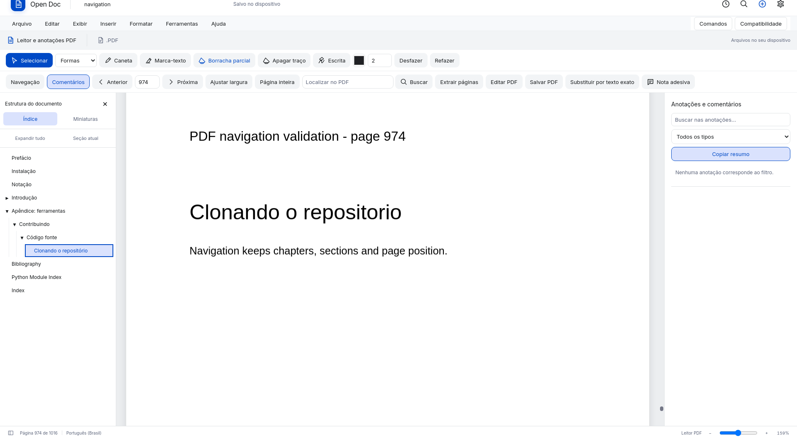
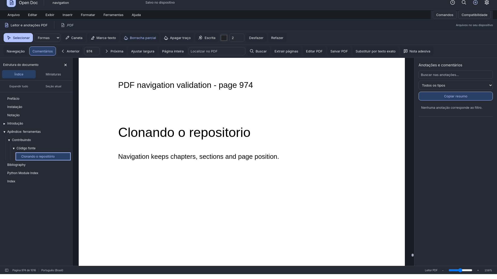
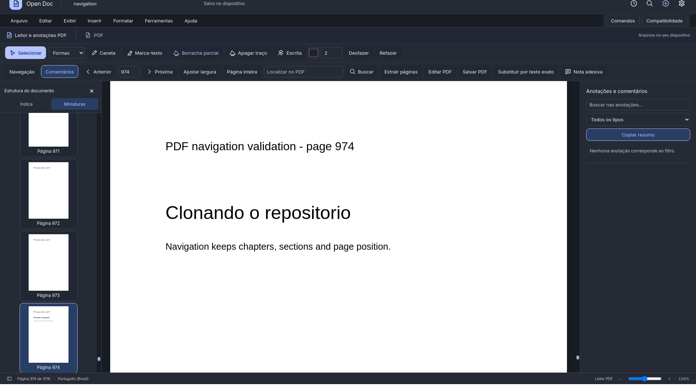

# Navegação do PDF: índice em árvore

A lista anterior usava `prepend` recursivo: invertia a ordem dos marcadores, removia visualmente a hierarquia e misturava capítulos com todas as miniaturas. O painel agora tem visualizações independentes de **Índice**, **Miniaturas** e **Busca**.

## Comportamento

- A ordem dos marcadores vem do arquivo, preservando capítulos e subcapítulos. O estado inicial de expansão respeita a indicação positiva/negativa do PDF.
- A seta ao lado do capítulo expande/recolhe sem mudar a página. O título navega para seu destino, inclusive marcadores nomeados e posições dentro da página.
- Setas para cima/baixo percorrem itens visíveis. Direita expande ou entra nos filhos; esquerda recolhe ou volta ao pai. Home/End e Enter/Espaço também funcionam.
- A seção atual fica destacada. **Seção atual** revela os ancestrais e localiza o marcador. Empates de destinos na mesma página usam a primeira entrada do nível mais profundo, na ordem do arquivo, independentemente da ordem de resolução assíncrona.
- **Expandir tudo/Recolher tudo** mantém o rótulo coerente com a árvore. O painel pode ser recolhido, reaberto e redimensionado; a divisória também aceita setas pelo teclado.
- Miniaturas são criadas somente quando a aba é aberta. Há no máximo duas renderizações concorrentes e cache de 24 miniaturas fora das páginas visíveis. A miniatura da página atual é destacada e localizada no painel.
- Resultados de busca ficam em sua própria aba, sem inserir botões dentro da árvore de capítulos.
- O rodapé informa `Página X de N`, evitando reaproveitar a posição do slide anterior ou concatenar dois totais de páginas.
- O acompanhamento da página visível usa busca binária sobre páginas ordenadas. A limpeza de renderização visita apenas páginas residentes, não todas as 1.016 páginas a cada rolagem.
- Índice malformado não interrompe a visualização: o leitor mantém o canvas e oferece miniaturas. A troca de documento cancela observadores e ignora resoluções antigas.

## Organização

`pdf_navigation.js` controla a árvore acessível, painéis, teclado, destaque e fila de miniaturas. `fixed_document.js` conserva a navegação/renderização do PDF e resolve destinos com caches por documento; um destino antigo nunca usa o índice de uma nova origem. `styles/pdf_navigation.css` é compilado pelo pipeline habitual.

A lógica foi comparada com o [PDFOutlineViewer do Mozilla PDF.js 4.10.38](https://github.com/mozilla/pdf.js/blob/v4.10.38/web/pdf_outline_viewer.js), a mesma família do leitor Firefox. A implementação do painel é própria; não se copiou o viewer completo nem o código do Firefox.

## Validação

```bash
python manage.py collectstatic --yes
node --test tests/regression/pdf_navigation.test.cjs tests/regression/fixed_rendering.test.cjs
python tools/qa_pdf_navigation.py
```

O QA requer o runtime gráfico Vela/Qt, como os demais scripts do projeto. O CI Windows/Linux usa um PDF sintético original com 1.016 páginas, índice multinível e destino na página 974. Não depende de download externo.

Também foi executada a validação local no arquivo público utilizado nas capturas: [Dive into Deep Learning em português](https://pt.d2l.ai/d2l-pt-pytorch.pdf), 1.016 páginas e 1.228 marcadores, com **Clonando o repositório → página 974**. Foram conferidos todos os títulos de primeiro nível e a contagem de marcadores contra os metadados do arquivo, mais seleção, teclado, miniaturas, busca e hash do original intacto.

Para repetir com uma cópia local desse PDF:

```bash
OPEN_DOC_QA_PDF=/caminho/d2l-pt-pytorch.pdf \
  OPEN_DOC_PDF_NAV_OUTPUT=/tmp/opendoc-pdf-navigation \
  python tools/qa_pdf_navigation.py
```

As capturas versionadas abaixo mostram o PDF sintético de teste; o livro não é incorporado ao repositório ou instalador.





## Caneta em documentos no modo contínuo

O fluxo contínuo remove as páginas físicas e, com elas, a superfície de tinta. Antes, a barra permitia ativar uma ferramenta sem nenhum destino para os eventos de desenho. Agora, selecionar Caneta, Marca-texto, Escrita, formas ou borrachas prepara automaticamente a visualização **Com páginas**. A mudança é somente visual: texto, objetos e coordenadas dos traços existentes são preservados. Escolher explicitamente Fluxo contínuo volta a Selecionar. PDFs mantêm suas próprias superfícies e independem dessa preferência do editor DOCX.

Se a paginação falhar, a ferramenta permanece em Selecionar e informa o problema, preservando o documento. O teste `tools/qa_continuous_ink.py` usa entrada nativa do mouse pelo QtWebEngine, zoom de 140%, pressão sintética, forma, marca-texto, apagar, desfazer/refazer e salvar/reabrir. Ele não valida o driver de uma mesa física.
